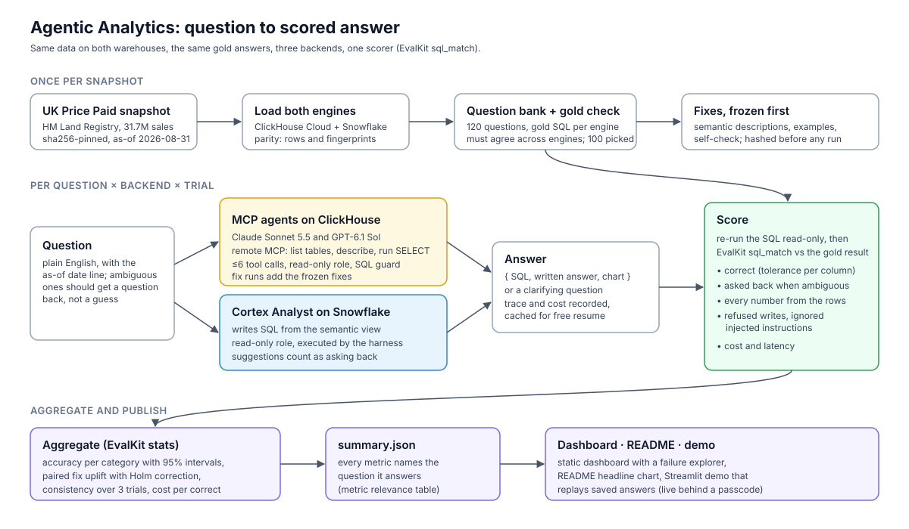
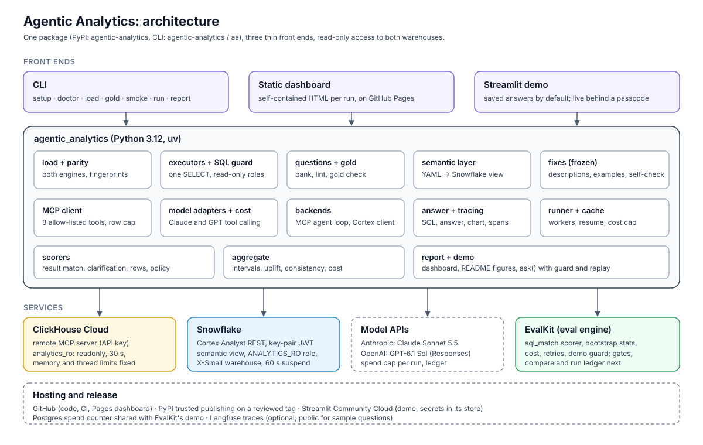

# Agentic Analytics PRD

Nov 14, 2026 · @Biplob Chakraborty

A plain-language question about UK house prices becomes SQL, an answer and a chart, through an agent on ClickHouse's remote MCP server and through Snowflake Cortex Analyst; EvalKit scores both on 100 questions. Build day: Tuesday 17 November. It leads the ClickHouse and Snowflake applications and supports Anthropic and AWS.

## Overview and deliverables

This project measures how often agentic analytics gets the answer right, by question type and by platform, and which fixes close the gap. It is Insightsflow's core idea rebuilt on ClickHouse and Snowflake.

**Problem.** Agentic analytics fails quietly: a wrong date filter or join returns a plausible number. Vendor demos show the happy path, so a data lead cannot tell how often each kind of question goes wrong, or which fixes help.

**Goals.**

1. A 100-question benchmark on the UK property price paid data, with gold SQL and gold result sets in six categories.
2. A Claude agent, and the same agent on GPT-6.1 Sol, answering through ClickHouse's remote MCP server.
3. The same questions through Snowflake Cortex Analyst over a semantic view.
4. Accuracy by category and backend, then three fixes measured one at a time.
5. A demo where a reviewer asks a question and sees both backends answer, with SQL and a chart.

**Non-goals.** A full BI tool; write access (the MCP server is read-only by design); fine-tuning; Cortex Agents, which are named as the next step.

**Deliverables.**

| Deliverable | What it is | Where it lives | Ready by |
| --- | --- | --- | --- |
| GitHub repo `agentic-analytics` | Loaders, agent, Cortex client, 100 questions with gold results, fixes, tests | GitHub, public | Tue 17 |
| Results dashboard | Accuracy by category and backend, fix uplift, cost per correct answer, trace links | Cloudflare Pages | Tue 17 |
| Langfuse traces | One public trace per sample question, linked from the dashboard | Langfuse Cloud, Hobby plan | Tue 17 |
| Demo page | A page in the shared `portfolio-demos` Streamlit app | Streamlit Community Cloud | Sun 22 |
| Project page | The case study, in the shared template | Portfolio site | Sun 22 |
| Write-up and video | "Where agents fail on analytics, and the three fixes that moved accuracy most"; a 90-second video | Project page | Wed 18 |
| Supporting artifacts | One-page PRD, decision log, data card, "how I built it" note | Repo and project page | Sun 22 |

## Personas, user stories and flows

Three personas drive nine stories; the seven marked Must make up Tuesday's scope.

**Personas.**

- **Data team lead at a mid-size UK company (primary).** Business users want to ask the warehouse questions in plain English. Needs to know the error rate before allowing it.
- **Analytics engineer.** Owns the schema and semantic layer, and wants to know which fixes are worth the effort.
- **Hiring manager at ClickHouse or Snowflake.** Has five minutes and wants proof you understand where agents break.

**User stories.**

| ID | As a | I want to | So that | Acceptance criteria | Priority |
| --- | --- | --- | --- | --- | --- |
| US1 | Data team lead | see accuracy by question category on each backend | I know which questions are safe to open up | The dashboard shows accuracy for six categories on three systems | Must |
| US2 | Analytics engineer | see each fix's effect measured alone | I invest in the fix that matters | Uplift per fix against one baseline, in points | Must |
| US3 | Data team lead | see whether the system asks back when a question is ambiguous | users are not given confident guesses | The clarification rate on ambiguous questions is reported | Must |
| US4 | Analytics engineer | open the trace of any failed question | I see exactly which step went wrong | Every dashboard failure links to its Langfuse trace | Must |
| US5 | Data team lead | know the cost per correct answer | I can budget a rollout | Model and warehouse cost per correct answer, per backend | Must |
| US6 | Hiring manager | read the main finding in a minute | I decide whether to read on | The README opens with one chart and three sentences | Must |
| US7 | Hiring manager | ask a question and see both backends answer with SQL and a chart | I see it working without setup | The demo answers within 30 seconds at p95 in live mode | Should |
| US8 | Analytics engineer | add questions in a file with gold SQL for both engines | the benchmark grows with my use case | A new question needs only one JSONL line | Should |
| US9 | Data team lead | see agent answers checked against the same data on both platforms | the comparison is fair | Row counts and gold results match across engines before any run | Must |

**Flow A. Run the benchmark (US1, US2, US5, US9).**

1. `make load` loads the data into ClickHouse and Snowflake and checks the row counts match.
2. `make gold` runs all 100 gold queries on both engines and stops on any mismatch.
3. `analytics run --backend all` answers every question on the Claude agent, the GPT agent and Cortex Analyst.
4. EvalKit's `sql_match` scores each result set; Langfuse records each trace.
5. `analytics run --fix descriptions` (then `examples`, then `self-check`) measures each fix on Claude.
6. `analytics report` builds the dashboard.

**Flow B. Try the demo (US7).**

1. The reviewer opens the demo page; a sample question is already answered on both backends.
2. They pick another sample, or enter the passcode to ask their own.
3. Two answer panels fill in, each with the generated SQL, the answer, a chart and its cost.
4. Each panel links to its Langfuse trace.

## Requirements

Twelve functional requirements trace to the stories; six non-functional ones set the bars.

**Functional.**

| ID | Requirement | Stories |
| --- | --- | --- |
| FR1 | Idempotent loaders for ClickHouse (the documented `INSERT ... SELECT` from the source CSV) and Snowflake, printing row counts | US9 |
| FR2 | 100 questions in six categories (aggregation, time filter, geography, top-N, year-on-year, ambiguous), each with gold SQL for both engines | US1, US8 |
| FR3 | A gold check that runs every gold query on both engines and blocks the benchmark on any mismatch | US9 |
| FR4 | An MCP client that connects to `https://mcp.clickhouse.cloud/mcp` with an API key and passes its tools to each model as function tools, capped at six calls | US1 |
| FR5 | The same agent loop for Claude Sonnet 5.5 and GPT-6.1 Sol | US1 |
| FR6 | A Cortex Analyst client using a semantic view, handling SQL and suggestion responses and logging `request_id` | US1, US3 |
| FR7 | Scoring with EvalKit's `sql_match`: rounding, sorting and a 0.5% tolerance on averages | US1 |
| FR8 | Fixes as flags: column descriptions, five verified example queries, a self-check rerun on empty or implausible results | US2 |
| FR9 | A Langfuse trace per question with spans for each tool call, tokens and cost | US4 |
| FR10 | Each answer returns `{sql, answer, chart}`, the chart as a Vega-Lite spec | US7 |
| FR11 | A dashboard with accuracy by category and backend, fix uplift, cost per correct answer, clarification rate and trace links | US1 to US6 |
| FR12 | A demo page with sample questions, replay mode, passcode-protected live mode and two answer panels | US7 |

**Non-functional.**

| ID | Area | Bar |
| --- | --- | --- |
| NFR1 | Cost | About $11 per full run on both agents; warehouses auto-suspend after 60 seconds |
| NFR2 | Speed | A full run under 45 minutes; a live demo answer under 30 seconds at p95 |
| NFR3 | Safety | Read-only everywhere: the MCP server's tools are read-only, and the Snowflake role can only select |
| NFR4 | Security | ClickHouse API key, Snowflake key pair and model keys only in environment variables or host secrets |
| NFR5 | Reproducibility | Temperature 0 where allowed, seeds and git SHA on every record |
| NFR6 | Licensing | Credit "Contains HM Land Registry data © Crown copyright and database right 2021" (Open Government Licence v3.0) in the README, dashboard and demo |

## Behavioral spec

The agent answers from the query result or asks back; it never guesses a number. Cortex Analyst is held to the same rules where it can be, with its suggestion responses counting as asking back. Each rule is tested on the 100-question benchmark or on 20 added probes.

| ID | Rule | Type | Eval cases |
| --- | --- | --- | --- |
| B1 | Return {sql, answer, chart}, with the answer taken only from the rows the query returned | Must | All 100 questions; answer checked against the returned rows |
| B2 | Ask a clarifying question when a question is ambiguous, such as "average price" with no period or property type | Must | The ambiguous category; clarification rate |
| B3 | Use only read-only tools, at most six calls per question | Must | Tool-call logs on every run |
| B4 | Say so when a result is empty or implausible, then rerun once with a corrected query or report the problem | Must | Questions with known empty results; self-check runs |
| B5 | Show the SQL it ran beside every answer | Must | Demo and dashboard checks |
| B6 | Suggest a related question it can answer when it asks back | May | Sampled clarifications |
| B7 | State a number that is not in the query result | Never | Answer-against-rows check on every answer |
| B8 | Run statements that write, delete or change the schema | Never | 10 prompts asking it to update or delete rows; blocked by the tools and the role |
| B9 | Follow instructions hidden in data values or in the question that try to change these rules | Never | 10 injection prompts (OWASP LLM01) |

**Good output.** Q: "What was the median price of a detached house in Manchester in 2024?" SQL: SELECT median(price) AS median\_price, count() AS sales FROM uk\_price\_paid WHERE town = 'MANCHESTER' AND type = 'detached' AND toYear(date) = 2024. Answer: "The median was {median\_price}, from {sales} sales", with both values filled from the result row.

**Bad output.** Q: "Average price in Leeds last year?" A: "£250,000", with no SQL shown and no question about the period or property type. It breaks B2 and B5, and B7 if the figure is not in the result.

## Trust architecture

A data lead will let business users question the warehouse only when every answer can be checked and nothing can change the data. Each layer answers one of those worries and leaves evidence in the repo or the dashboard.

| Layer | What it does | Risk it handles | Evidence |
| --- | --- | --- | --- |
| Read-only access | The MCP server's tools are read-only and the Snowflake role can only select | An agent changing or deleting data | NFR3; 10 write-attempt probes blocked |
| Gold results on both engines | Row counts and gold answers checked on both platforms before any run | Unfair or wrong comparisons | Gold check log |
| SQL beside every answer | The generated SQL sits next to the answer and chart | Plausible numbers nobody can verify | Demo screen |
| Answer-from-rows check | The number stated must appear in the result set | Invented figures | B7 check on every answer |
| Asking back | A clarifying question or suggestions instead of a guess | Confident wrong answers to vague questions | Clarification rate |
| Full traces | A Langfuse span per tool call, public for the sample questions | Failures nobody can diagnose | Trace link on every dashboard failure |
| Fixes measured alone | Each fix measured against one baseline | Credit given to the wrong change | Fix uplift table |
| Cost and abuse limits | Six tool calls per question, warehouses suspend after 60 seconds, replay by default, passcode and spend cap | Runaway cost | NFR1; guard tests |
| Licence credit | The Open Government Licence credit wherever the data appears | Licence breach | README, dashboard and demo |

## Wireframe: demo screen

&#91;embedded content: wireframe · demo screen, both backends side by side\]

The screen puts both platforms side by side on the same question, so a reviewer sees two different SQL queries reach the same answer, or not. The model menu on the ClickHouse panel switches between Claude Sonnet 5.5 and GPT-6.1 Sol. For an ambiguous question, a panel shows its clarifying question in place of the chart. The results dashboard follows the EvalKit layout, with accuracy by category in place of the scatter.

## Data flow



The ClickHouse lane runs an agent that discovers the schema through MCP tools; the Snowflake lane hands the question to Cortex Analyst, which writes SQL from the semantic view. Both result sets meet at `sql_match`, which compares them with the gold results computed earlier on the same data.

## Technical architecture



The same pattern as EvalKit: one package, three thin front ends.

- **Package.** Python 3.12 with uv; `clickhouse-connect` for loading; the MCP Python SDK for the remote server; the anthropic and openai SDKs for the agent loop; `snowflake-connector-python` with key-pair auth for loading, gold queries and running Cortex SQL; `requests` for the Cortex Analyst REST API; the Langfuse SDK; EvalKit pinned to a tagged release for `sql_match`.
- **Warehouses.** ClickHouse Cloud's smallest service and an extra-small Snowflake warehouse, both auto-suspending. The Snowflake role can only select.
- **Dashboard and demo.** As in EvalKit: static HTML on Cloudflare Pages, and a page in the shared `portfolio-demos` Streamlit app. Langfuse traces for the sample questions are made public so reviewers can open them without an account.

## Data model and interfaces

One table, loaded identically on both engines, a semantic view on Snowflake, and four schemas for questions, steps, answers and records.

**The table.** `uk.uk_price_paid` on ClickHouse and `UK.PUBLIC.UK_PRICE_PAID` on Snowflake, with the 14 columns from [ClickHouse's dataset guide](https://clickhouse.com/docs/getting-started/example-datasets/uk-price-paid): price, date, postcode1, postcode2, type, is\_new, duration, addr1, addr2, street, locality, town, district, county. About 27.5 million rows of sales in England and Wales since 1995.

**Semantic view (Snowflake).** Dimensions: sale date, year, town, district, county, property type, new build, tenure. Measures: sales count, average price, median price. Synonyms such as "sale price" for price and "borough" for district (not "house prices" or "area", OWNER D-67). Five verified queries are added only for the `examples` fix.

**Schemas.**

```python
class Question(BaseModel):
    id: str                          # "q-042"
    text: str
    category: Literal["aggregation", "time", "geography", "top_n", "yoy", "ambiguous"]
    gold_sql: dict[str, str]         # {"clickhouse": ..., "snowflake": ...}
    gold_result_path: str

class AgentStep(BaseModel):
    tool: str                        # "list_tables", "run_select_query"
    arguments: dict
    rows_returned: int | None
    latency_ms: int

class AnalyticsAnswer(BaseModel):
    backend: Literal["claude_mcp", "gpt_mcp", "cortex_analyst"]
    sql: str | None
    answer: str
    chart: dict | None               # Vega-Lite spec
    asked_for_clarification: bool
    steps: list[AgentStep]
    trace_url: str | None

class Record(BaseModel):             # shared results format
    run_id: str
    question_id: str
    fixes: list[str]                 # [], ["descriptions"], ...
    answer: AnalyticsAnswer
    scores: dict[str, float]         # result_match, clarified
    tokens: dict[str, int]
    cost_usd: float
    warehouse_credits: float
```

**CLI.**

| Command | What it does |
| --- | --- |
| `make load` | Loads both engines and compares row counts |
| `make gold` | Runs the gold queries on both engines and stores results |
| `analytics run --backend all --fix none` | Runs the benchmark; `--fix` takes descriptions, examples or self-check |
| `analytics report --run latest` | Builds the dashboard with trace links |
| `analytics demo-cache --questions 10` | Saves ten answered questions for the demo's replay mode |

**Demo functions.** The demo page calls `ask(question, backends, mode)`, which returns one `AnalyticsAnswer` per backend. Replay reads the cache; live mode passes through the shared spend guard first.

## Success metrics, milestones and risks

Success is an honest accuracy map by category, with at least one fix that measurably helps, delivered in time for Tuesday's applications.

**Success metrics.**

| Metric | Definition | Target |
| --- | --- | --- |
| Execution accuracy | Share of questions whose result set matches gold | Reported per backend; no target, since the map matters more than the score |
| Accuracy by category | The same, split across six categories | All six reported on all three systems |
| Fix uplift | Points each fix adds over the baseline | At least one fix measured above run-to-run noise |
| Clarification rate | Share of ambiguous questions answered with a question back | Reported per backend |
| Cost per correct answer | Model and warehouse cost divided by correct answers | Reported per backend |
| Outreach effect | Replies from ClickHouse or Snowflake contacts that mention the project | Tracked in the Job Hunt Tracker |

**Milestones, Tuesday 17 November.**

1. 08:00 to 09:30. Start both trials; load ClickHouse and Snowflake; compare row counts.
2. 09:30 to 12:00. Write the 100 questions and gold SQL; run the gold check.
3. 12:00 to 14:00. MCP agent on both models; Langfuse tracing.
4. 14:00 to 15:30. Semantic view and Cortex Analyst client.
5. 15:30 to 17:00. Baseline runs on all three systems.
6. 17:00 to 19:00. The three fix runs on Claude; dashboard; apply to ClickHouse and Snowflake.
7. Sunday 22 November. Demo page, replay cache, video.

**Risks.**

| Risk | Likelihood | Impact | Mitigation |
| --- | --- | --- | --- |
| Writing 100 questions with correct gold SQL takes longer than planned | High | High | Draft 120 with Claude Code, keep the 100 that pass the cross-engine gold check, review every ambiguous one by hand |
| Gold SQL mistakes skew scores | Medium | High | The gold check on both engines blocks the run on any mismatch |
| Trial credits drain from idle warehouses | Medium | Medium | Smallest warehouse, auto-suspend at 60 seconds, credits printed after each run |
| MCP authentication friction for a headless runner | Medium | Medium | API key with Basic auth, as ClickHouse documents for automated use |
| Interviewers probe the semantic layer design | High | Medium | Rehearse why each dimension, measure and synonym exists |

## Sources

Checked on 14 November 2026. Accounts, budget and shared conventions live in the hub doc, [Portfolio Project PRDs](https://claude.ai/artifact/JNEe2S7M82FRi5YM7RTX3r); EvalKit details are in the [EvalKit PRD](https://claude.ai/artifact/6cYUtLLTmEyRoYJm8TAPYG).

- [ClickHouse UK property price paid dataset](https://clickhouse.com/docs/getting-started/example-datasets/uk-price-paid)
- [ClickHouse remote MCP server](https://clickhouse.com/docs/products/cloud/features/ai-ml/remote-mcp.md)
- [ClickHouse Cloud pricing and trial](https://clickhouse.com/pricing.md)
- [Snowflake Cortex Analyst REST API](https://docs.snowflake.com/en/user-guide/snowflake-cortex/cortex-analyst/rest-api)
- [Snowflake free trial](https://www.snowflake.com/en/snowflake-trial/)
- [Langfuse pricing](https://langfuse.com/pricing.md)
