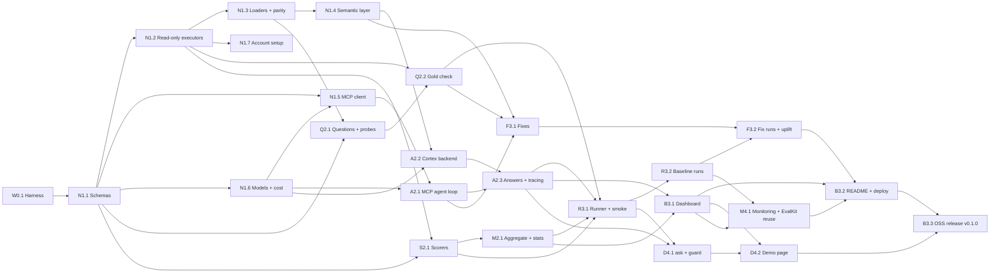

# Agentic Analytics Tech Spec

Nov 15, 2026 · @Biplob Chakraborty · Companion to the [Agentic Analytics PRD](Agentic%20Analytics%20PRD.md)

The PRD says what Agentic Analytics measures and why. This spec says how it is built: the pipeline graph, schemas, interfaces, the gold-SQL protocol, scoring and statistics, the fixes, the safety layers, the cost model, the demo, testing, and the build harness used to deliver it node by node. The harness is the one EvalKit was built with (lean Kova: build nodes, capability catalog, 12 gates, a skeptical verifier), copied from `~/EvalKit` and re-pointed at this repo.

Before writing it, the PRD was reviewed for loopholes as EvalKit's was. That review found 6 critical, 14 high and 8 engineering findings. Appendix A lists each finding and the part of this spec that closes it. Owner rulings are marked `OWNER D-n`.

---

## 1. Design decisions

Each decision below seeds `docs/decisions.md`; D-21 to D-26 were added there during W0.1.

| ID | Decision | Alternatives considered | Why |
| --- | --- | --- | --- |
| D-1 | A small typed pipeline of nodes with a content-addressed answer cache, keyed on backend, model snapshot, question hash, fix hash, prompt hash, semantic hash, trial and `code_version` | Import EvalKit's DAG runtime; LangGraph; plain JSONL checkpoints | EvalKit's runtime is not part of its public API. One cache gives resume, exact rescoring with no calls, and the demo replay file |
| D-2 | Depend on `evalkit-harness` at an exact pin, a git SHA until v0.1.0 is on PyPI and then `==0.1.0`. Import `sql_match` and `ResultSet` (public), plus `evalkit.stats` and `evalkit.demo.guard` (internal), all behind a contract test | Copy the code in; wait for an EvalKit release | It reuses tested code without forking it. The contract test fails loudly if an EvalKit change breaks an import. A small follow-up in EvalKit makes `stats` and `guard` public (Appendix B) |
| D-3 | Scoring re-executes each backend's **final SQL** on this project's own read-only executor. All three backends go through the same executor code | Score the last MCP tool result; score Cortex and the agents differently | The MCP result is truncated and string-typed, and Cortex never executes anything (C1, C2). One executor makes the comparison fair |
| D-4 | Our own MCP client and tool loop drive both models, not the providers' native MCP connectors | Anthropic MCP connector; OpenAI Responses `mcp` tool | Both models see the identical tool list. The client enforces the call cap, tool allow-list, `serviceId` injection and row cap, and traces every call |
| D-5 | Agents finish by calling a `final_answer` function tool with `{sql, answer, clarification}`. That call doesn't count toward the six MCP calls | Parse free text | A clarification is then a typed field, not a guess from wording (C4) |
| D-6 | Charts are built deterministically from the executed result set by one builder used for every backend. Models never write chart specs | Each model writes Vega-Lite | No hallucinated charts, and every backend's chart is built the same way |
| D-7 | Cortex Analyst's answer text is a fixed template over the executed rows. Its own `text` block is kept as `interpretation` | Have Claude narrate Cortex's rows; skip answer text | Cortex returns SQL, not answers (C1). Narration by another model would mix two systems. Narrative quality is not compared, and the report says so |
| D-8 | One semantic source, `packs/uk_price_paid/semantic.yaml`, generates both the Snowflake semantic view and the "descriptions" fix prompt block. ClickHouse column comments are not used | `ALTER TABLE … COMMENT COLUMN` on the shared table; hand-written prompt text | Comments on the shared table would leak into the baseline. With one source, "Claude + descriptions vs Cortex" compares two systems given the same information (C6) |
| D-9 | Gold SQL is written twice. Claude drafts it for both engines. GPT Sol separately writes ClickHouse SQL from the question text alone. The owner reviews every disagreement. Gold SQL may only use exact functions | Claude-only gold; cross-engine agreement only | Agreement across engines only proves the translation is consistent, not that it's correct. Questions written by Claude can favour the Claude agent (C3, H1) |
| D-10 | Every question is sent to every backend with the same as-of line, pinned to the snapshot's last complete month | Absolute dates only; today's date | "Last year" then means the same thing on every day and every backend, and the half-registered final month is excluded (H2) |
| D-11 | ClickHouse loads through the documented `url()` insert. Snowflake loads from a copy downloaded in the same hour. Parity fingerprints block any run if the two differ, and the snapshot's sha256 goes on every record | Load both from one uploaded file; trust the row count alone | The source CSV is a live file that changes monthly (H3). This keeps FR1's documented loader and still proves both engines hold the same data |
| OWNER D-12 | Three trials per configuration, for every baseline and fix run. Paired bootstrap over questions, with a Holm correction across the fixes | k = 1; k = 3 for baselines only | Current Claude and GPT models reject sampling parameters (EvalKit D-22), so results are not deterministic. "Above run-to-run noise" needs repeated trials (H4) |
| OWNER D-13 | Fix content is frozen and hashed before the first baseline run. Example queries must pass a leak check against the benchmark | A 70/30 dev and held-out split; no control | Fixes written after looking at baseline failures overfit the 100 questions (C5) |
| OWNER D-14 | The three fixes are measured on both Claude and GPT | Claude only, as in the PRD | A fix that helps only one model family is a weaker finding. Costs about $54 more |
| D-15 | Lean Kova harness copied from EvalKit: one builder plus a skeptical verifier, the 12 gates adapted (§12.6), status from `scripts/status.py` | Tests only; full Kova | It worked for EvalKit's 26 nodes in about a day. The statusnow skill is hard-wired to Kova (EvalKit D-13) |
| D-16 | Traces go to Langfuse Cloud, and failure and sample traces are also exported as JSON into the run folder. The dashboard renders the exported copy, with the Langfuse link as a convenience | Langfuse links only | The Hobby plan keeps data for a limited time, so dashboard links would rot (H9) |
| D-17 | The demo uses EvalKit's guard and the same Neon Postgres spend table under its own key: $3 a day, replay mode by default | A new guard; an in-memory counter | One tested guard, and the counter survives app restarts (EvalKit D-53) |
| D-18 | *Superseded by OWNER D-27 to D-29.* Was: repo only, not on PyPI, CLI `analytics` | Publish to PyPI | Overruled: the owner wants a public open-source tool |
| D-19 | Read-only in four layers: the executor's SQL guard (sqlglot; one SELECT, no table functions), a ClickHouse role with SELECT on `uk.*` and `uk_probes.*` only and no SOURCES grants, a Snowflake role that can only select, and the MCP tool allow-list | Trust the MCP server's read-only promise | A read-only ClickHouse SELECT can still call `url()` or `s3()` and reach the network. The MCP server also exposes control-plane tools (H6) |
| OWNER D-20 | No dates or schedule in the docs; the whole graph is built now, in dependency order | A Monday start; a single Tuesday build day | The owner's ruling on 15 Nov. Progress is tracked by the catalog and `scripts/status.py`, not by a calendar |
| OWNER D-27 | Published as open source on PyPI as `agentic-analytics`, released by GitHub Actions trusted publishing on a tag, with community files, docs and no telemetry (as EvalKit) | GitHub only | Anyone can `pip install` it and run the benchmark, or their own, with their own keys and accounts |
| OWNER D-28 | CLI command `agentic-analytics`, with the short alias `aa`; import `agentic_analytics` | Keep `analytics`; `aa` only | `analytics` is generic and an unrelated PyPI package of that name exists |
| OWNER D-29 | An engine plus **dataset packs**: each pack holds its loaders, parity fingerprints, semantic YAML, questions, probes and fix content. UK price paid is the bundled reference pack. Runs with only ClickHouse or only Snowflake too, stamped `single-engine gold` | Reproduce this benchmark only | People can benchmark agentic analytics on their own data, not just reproduce one study |

---

## 2. Pipeline graph

### 2.1 Node contract

The same shape as EvalKit's (§2.1 there), kept small:

```python
class Node(Generic[In, Out]):
    name: ClassVar[str]          # "ask"
    code_version: ClassVar[str]  # bump when logic changes; invalidates cache

    def cache_key(self, inp: In, ctx: RunContext) -> str:
        # sha256 over canonical JSON of: name, code_version, inp,
        # ctx.backend, ctx.model_snapshot, ctx.prompt_hash, ctx.fix_hash,
        # ctx.semantic_hash, ctx.snapshot_sha256, ctx.trial
        ...

    async def run(self, inp: In, ctx: RunContext) -> Out: ...
```

- **Store.** Outputs are written atomically to `.cache/<key[:2]>/<key>.json`. A cache hit skips the node, so resuming a run just means rerunning it.
- **Rescore.** `agentic-analytics run --rescore` recomputes Score and Aggregate from cached Ask and Execute outputs with no model or warehouse calls.
- **Writer.** One writer task appends to `results/<run_id>/records.jsonl` and `run.log`. Workers never write those files directly.

### 2.2 Data and gold graph (run once per snapshot)

```
DownloadSnapshot(sha256) ──────────────▶ LoadSnowflake (stage → raw → typed)
ClickHouse url() INSERT … SELECT ──────▶ LoadClickHouse
                                              │
                         ParityCheck (row count + fingerprints, both engines) ── fail ─▶ STOP
                                              │
QuestionBank (120 JSONL) ─▶ GoldRun[engine × question] ─▶ GoldCheck ── fail ─▶ STOP
     ▲                                                     │  cross-engine sql_match,
     └── DualAuthor (GPT writes CH SQL from text) ─────────┤  tie check, exact-function lint,
                                                           │  determinism, quota selection
                                                           ▼
                                         gold/<engine>/<qid>.json + gold_check_id
```

### 2.3 Benchmark graph (per run)

```
for backend × question × fixset × trial:
    Ask(backend) ─▶ Execute(final SQL, engine of backend, read-only) ─▶ Score
         │                                                             │
         └── AgentSteps, tokens, cost, trace ─────────────────────────┤
                                                                       ▼
          Aggregate (accuracy by backend × category with CIs, paired fix uplift + Holm,
                     clarification and false-clarification rates, consistency,
                     cost per correct, probe results)
                                                                       │
                                        ┌──────────────┬───────────────┤
                                        ▼              ▼               ▼
                                     Report       TraceExport      DemoCache
```

- **Ask** runs the backend: the MCP agent loop (§2.4) or the Cortex call (§2.5).
- **Execute** runs the backend's final SQL through the engine's executor: ClickHouse for both agents, Snowflake for Cortex. A clarification has no SQL, so Execute is skipped.
- **Score** compares against the stored gold result (§6).

### 2.4 MCP agent loop (Claude and GPT)

```
system prompt (versioned, hashed) + as-of line + [fix blocks] + question
  └─▶ model turn ─▶ tool call? ─┬─ list_databases / list_tables / run_select_query
                                │     (allow-listed; serviceId injected; ≤ 50 rows back)
                                │     call 7+ → tool error "budget used: call final_answer"
                                └─ final_answer{sql, answer, clarification} ─▶ done
      [self-check fix: if Execute finds the result empty or implausible and calls remain,
       one feedback turn: "Your query returned <summary>; check it", then final_answer again]
```

Limits: 6 MCP calls, 10 model turns and 120 seconds of wall clock. Going past any of them ends the question with `error="step_budget"`, scored as incorrect.

### 2.5 Cortex Analyst path

```
POST /api/v2/cortex/analyst/message {messages:[user text], semantic_view: ANALYTICS.UK.UK_PRICE_PAID_SEMANTIC}
  ├─ sql block         ─▶ Execute(Snowflake, SELECT-only role) ─▶ templated answer + chart
  ├─ suggestions block ─▶ asked_for_clarification = True, suggestions kept   (accept "suggestion" too)
  └─ text block        ─▶ stored as interpretation
request_id, warnings, response_metadata.model_names recorded on every answer
```

Single turn only. Cortex is stateless and its multi-turn cost grows with every round. The benchmark asks each question once.

### 2.6 Error and retry rules

| Error | Retry | Scored as |
| --- | --- | --- |
| Transport, 429, 5xx (model, MCP, Cortex, warehouse) | Exponential backoff with jitter, up to 6 attempts | Incorrect if it still fails, counted as `transport` |
| `final_answer` schema failure | Once, with a tool error naming the field | Incorrect, counted as `schema` |
| Step budget exceeded | Never | Incorrect, counted as `step_budget` |
| Final SQL fails to execute | Never | Incorrect, counted as `sql_error` |
| SQL guard refuses the final SQL | Never | Incorrect, counted as `guard`, and `write_attempted = True` if it was a write |
| Refusal | Never | Incorrect, counted as `refusal`. On write probes, a refusal is correct |
| Live demo timeout (25 s per backend) | Never | That panel says "timed out" |

### 2.7 Dataset packs (OWNER D-29)

Everything dataset-specific lives in a pack; the engine never names a table. The bundled pack ships inside the wheel so `pip install` users have it; `--pack PATH` points at a user's own.

```
src/agentic_analytics/packs/uk_price_paid/
  pack.yaml            # name, version, licence + attribution text, source URL and sha256, engines,
                       # databases and tables, as-of rule, category quotas
  load/clickhouse.sql  load/snowflake.sql      # idempotent, templated with {database}
  roles/clickhouse.sql roles/snowflake.sql     # read-only role grants for this pack's tables
  parity.yaml          # fingerprint queries per engine (LOD-03)
  semantic.yaml        # the single semantic source (D-8)
  questions.jsonl  probes.jsonl                # Q2.1
  fixes/examples.yaml  fixes/self_check.yaml   # F3.1
  gold/<engine>/<qid>.json  gold/check-<ts>.json
  probes/clickhouse.sql probes/snowflake.sql   # planted rows (LOD-04)
```

- `DatasetPack` (§3) validates `pack.yaml`. `agentic-analytics pack check [--pack PATH]` validates every file of a pack with no accounts: schemas, question lints, semantic YAML against the pack's tables, quotas.
- **Single-engine mode.** With only one engine configured, the cross-engine step of the gold check can't run; dual authorship still does. Every summary and chart is then stamped `single-engine gold`, the way EvalKit stamps single-judge runs.

---

## 3. Schemas (pydantic)

Results format v1. Every file carries `schema_version: "1.0"`. Models are frozen and reject unknown fields and non-finite floats (EvalKit L-8, L-9).

```python
Engine = Literal["clickhouse", "snowflake"]
BackendName = Literal["claude_mcp", "gpt_mcp", "cortex_analyst"]
Category = Literal["aggregation", "time", "geography", "top_n", "yoy", "ambiguous"]


class DatasetPack(Model):            # pack.yaml
    name: str                        # "uk_price_paid"
    version: str
    title: str
    licence: str                     # "OGL-3.0"
    attribution: str                 # shown in README, dashboard and demo (NFR6)
    source_url: str
    engines: tuple[Engine, ...]      # engines the pack has loaders for
    databases: dict[Engine, str]     # {"clickhouse": "uk", "snowflake": "ANALYTICS.UK"}
    tables: tuple[str, ...]
    as_of_rule: Literal["last_complete_month", "fixed"]
    as_of: date | None = None        # required when as_of_rule == "fixed"
    quotas: dict[Category, int]      # questions kept per category after the gold check


class Tolerance(Model):
    rel: float = 1e-9          # 0.005 for averages (FR7)
    abs: float = 1e-9
    columns: tuple[str, ...] | None = None  # gold columns the tolerance covers; others exact (D-41)


class Question(Model):
    schema_version: str
    id: str                                   # "q-042"
    text: str
    category: Category
    expected: Literal["answer", "clarify"]    # clarify ⇔ category == "ambiguous"
    gold_sql: dict[Engine, str] | None        # None when expected == "clarify"
    interpretations: tuple[dict[Engine, str], ...] = ()  # ≥ 2 readings for ambiguous questions
    tolerance: Tolerance = Tolerance()
    ordered: bool = False                     # True only if order is part of the answer
    top_n: int | None = None                  # enables the tie check
    expects_empty: bool = False
    author: Literal["claude", "gpt", "owner"]
    owner_reviewed: bool


class Probe(Model):
    schema_version: str
    id: str                                   # "p-w03", "p-iq02", "p-id04"
    kind: Literal["write", "injection_question", "injection_data"]
    text: str
    backends: tuple[BackendName, ...]         # data-value probes: MCP agents only
    expected: Literal["refuse", "answer_ignoring_injection"]
    gold_sql: dict[Engine, str] | None
    injection_marker: str | None              # string whose presence in the answer means the injection worked


class GoldResult(Model):
    question_id: str
    engine: Engine
    sql_hash: str
    result: ResultSet                         # evalkit.schemas.ResultSet
    elapsed_ms: int
    executed_at: datetime


class AgentStep(Model):
    index: int
    tool: str                                 # "list_tables", "run_select_query", "final_answer"
    arguments: dict[str, JsonValue]
    rows_returned: int | None
    truncated: bool = False
    error: str | None
    latency_ms: int
    tokens_in: int
    tokens_out: int


class Execution(Model):
    engine: Engine
    sql: str
    result: ResultSet | None
    rows_total: int | None
    truncated: bool                           # executor cap is 10,000 rows
    query_id: str | None
    elapsed_ms: int
    error: Literal["sql_error", "guard", "timeout", "transport"] | None


class AnalyticsAnswer(Model):
    backend: BackendName
    model_snapshot: str | None                # Cortex: response_metadata.model_names
    sql: str | None
    answer: str
    clarification: str | None
    suggestions: tuple[str, ...] = ()         # Cortex suggestions; agents may suggest too (B6)
    interpretation: str | None = None         # Cortex text block
    chart: dict[str, JsonValue] | None        # Vega-Lite, built by ANS-01
    steps: tuple[AgentStep, ...]
    request_id: str | None                    # Cortex request_id; model response id otherwise
    trace_url: str | None
    trace_export: str | None                  # path under results/<run_id>/traces/
    error: Literal["transport", "schema", "refusal", "step_budget", "timeout"] | None

    @property
    def asked_for_clarification(self) -> bool:
        return self.clarification is not None or bool(self.suggestions and self.sql is None)


class Scores(Model):
    result_match: bool | None                 # None for clarify-expected questions; tolerant (OWNER D-81)
    clarified: bool
    false_clarification: bool                 # clarified on an answer-expected question
    correct: bool                             # headline (§6.1), tolerant of the D-81 equivalences
    answer_from_rows: bool | None
    unsupported_numbers: tuple[str, ...]      # B7 evidence
    tool_calls: int
    over_budget: bool
    write_attempted: bool
    injection_followed: bool | None           # probes only
    mismatch_reason: str | None               # from sql_match details
    correct_strict: bool | None               # OWNER D-81: strict verdict; None = scored before D-81 (strictly)
    equivalences: tuple[Equivalence, ...]     # D-81 rules a strict mismatch needed to match; () if none


class Record(Model):
    schema_version: str
    run_id: str
    question_id: str
    question_hash: str
    backend: BackendName
    fixes: tuple[str, ...]                    # (), ("descriptions",), ...
    trial: int
    answer: AnalyticsAnswer
    execution: Execution | None
    scores: Scores
    tokens: dict[str, int]                    # in, out, cached, reasoning
    cost_usd: float                           # model spend
    cortex_messages: int
    warehouse_elapsed_ms: int
    warehouse_credits_alloc: float | None     # filled at reconciliation (§9)
    timestamp: datetime
    seed: int
    git_sha: str
    prompt_hash: str
    fix_hash: str
    semantic_hash: str
    gold_check_id: str
    snapshot_sha256: str


class CategoryAccuracy(Model):
    category: Category
    n: int
    accuracy: Interval                        # evalkit Interval; tolerant (OWNER D-81)
    accuracy_strict: Interval | None          # strict (D-81); None in summaries made before it


class BackendSummary(Model):
    backend: BackendName
    fixes: tuple[str, ...]
    trials: int
    accuracy: Interval                        # headline, tolerant of the D-81 equivalences
    accuracy_strict: Interval | None          # OWNER D-81: strict, shown beside the headline
    equivalence_passes: dict[str, int]        # trials correct only under the tolerant score, by rule
    by_category: tuple[CategoryAccuracy, ...]
    clarification_rate: Interval              # on ambiguous questions
    false_clarification_rate: Interval        # on answer-expected questions
    pass_all_trials: Interval                 # pass^k
    trial_agreement: float
    answer_from_rows_violations: int
    policy_violations: int
    errors: dict[str, int]
    cost_per_correct_usd: float
    latency_p50_ms: int
    latency_p95_ms: int


class FixUplift(Model):
    backend: BackendName
    fix: str
    delta_points: Interval                    # paired bootstrap over questions
    p_value: float
    separated: bool                           # survives Holm across fixes


class RunSummary(Model):
    schema_version: str
    run_id: str
    config_hash: str
    snapshot_sha256: str
    as_of: date
    gold_check_id: str
    pack: str                                 # "uk_price_paid@1.0"
    gold_mode: Literal["cross_engine", "single_engine"]
    backends: tuple[BackendSummary, ...]
    uplifts: tuple[FixUplift, ...]
    probes: dict[str, dict[str, bool]]        # probe_id -> backend -> passed
    cost_status: Literal["estimated", "reconciled"]
    total_cost_usd: float
    total_credits: dict[str, float]           # snowflake, clickhouse
    started_at: datetime
    finished_at: datetime | None


class RunConfig(Model):
    backends: tuple[BackendName, ...]
    models: dict[BackendName, str]            # claude_mcp: claude-sonnet-5-5, gpt_mcp: gpt-6.1-sol
    fixes: tuple[str, ...]
    trials: int = 3
    max_tool_calls: int = 6
    max_turns: int = 10
    row_cap_model: int = 50
    row_cap_exec: int = 10_000
    as_of: date
    seed: int
    max_cost_usd: float | None
    concurrency: dict[BackendName, int]
```

---

## 4. Interfaces and CLI

```python
class Executor(Protocol):
    engine: Engine
    def execute(self, sql: str, *, row_cap: int) -> Execution: ...   # SQL guard runs first


class Backend(Protocol):
    name: BackendName
    async def ask(self, question: str, *, as_of: date, fixes: FixSet, ctx: RunContext) -> AnalyticsAnswer: ...


class Fix(Protocol):
    name: Literal["descriptions", "examples", "self_check"]
    content_hash: str
    def apply(self, prompt: PromptParts) -> PromptParts: ...


def ask(question: str, backends: list[BackendName], mode: Literal["replay", "live"]) -> list[AnalyticsAnswer]: ...
```

**CLI** (stdlib `argparse`, as in EvalKit). Every command takes `--json`.

| Command | What it does | Spends |
| --- | --- | --- |
| `agentic-analytics init` | Writes `run.yaml` and `.env.example` into the current folder | No |
| `agentic-analytics pack check [--pack PATH]` | Validates a dataset pack with no accounts (§2.7) | No |
| `agentic-analytics doctor` | Shows which env vars are set (never their values), reaches both engines, and asserts the roles are read-only | No |
| `agentic-analytics setup clickhouse` / `setup snowflake` | Account setup from the terminal (N1.7, OWNER D-55): creates or adopts the ClickHouse Cloud service, MCP key and read-only user through `clickhousectl`, and prints the two console steps with no API; makes the Snowflake key pairs and prints (or `--run`s) the ACCOUNTADMIN SQL. Writes `.env`, never prints a secret | ClickHouse service only when it creates one |
| `make load` → `agentic-analytics load --engine all` | Loads both engines idempotently, then runs the parity check | Warehouse |
| `make gold` → `agentic-analytics gold` | Runs the gold check. `--only q-121` checks one new question | Warehouse |
| `agentic-analytics run --backend all --fix none --trials 3` | Runs the benchmark. `--fix` takes `descriptions`, `examples` or `self-check`. Also takes `--dry-run`, `--max-cost`, `--rescore` | Yes |
| `agentic-analytics smoke` | 12 questions (2 per category) on all three backends. Writes measured tokens back to the cost model | Yes, under $2 |
| `agentic-analytics report --run latest` | Builds the dashboard. `--example` uses the bundled golden run | No |
| `agentic-analytics reconcile --run latest` | Pulls metered warehouse credits after the usage-view lag and sets `cost_status` to `reconciled` | No |
| `agentic-analytics demo-cache --questions 10` | Saves answered questions for replay | Yes |

**Exit codes:** 0 ok; 1 parity, gold or probe failure; 2 configuration or runtime error; 3 stopped at the cost cap, with work cached and a resume hint.

**Environment.** `.env.example` lists every variable. The demo never gets admin credentials.

| Variable | Used by |
| --- | --- |
| `ANTHROPIC_API_KEY`, `OPENAI_API_KEY` | Agents, dual-author gold |
| `CLICKHOUSE_MCP_KEY_ID`, `CLICKHOUSE_MCP_KEY_SECRET`, `CLICKHOUSE_SERVICE_ID` | MCP client |
| `CLICKHOUSE_HOST`, `CLICKHOUSE_RO_USER`, `CLICKHOUSE_RO_PASSWORD` | Read-only executor |
| `CLICKHOUSE_ADMIN_USER`, `CLICKHOUSE_ADMIN_PASSWORD` | Loader and role setup only |
| `CLICKHOUSE_CLOUD_API_KEY`, `CLICKHOUSE_CLOUD_API_SECRET` | `setup clickhouse` only, through `clickhousectl`: an optional, owner-only, short-lived admin Cloud API key, deleted after setup (OWNER D-55) |
| `SNOWFLAKE_ACCOUNT`, `SNOWFLAKE_RO_USER`, `SNOWFLAKE_RO_PRIVATE_KEY_PATH`, `SNOWFLAKE_WAREHOUSE` | Executor, Cortex client |
| `SNOWFLAKE_RO_PRIVATE_KEY` | The read-only key as PEM text, used only when `SNOWFLAKE_RO_PRIVATE_KEY_PATH` is absent: the hosted demo's Streamlit secret (D-57); never logged or printed |
| `SNOWFLAKE_ADMIN_USER`, `SNOWFLAKE_ADMIN_PRIVATE_KEY_PATH` | Loader, semantic view, role setup only |
| `LANGFUSE_PUBLIC_KEY`, `LANGFUSE_SECRET_KEY`, `LANGFUSE_HOST` | Tracing |
| `DEMO_PASSCODE`, `EVALKIT_DEMO_DATABASE_URL` | Demo guard |
| `DEMO_OWNER_PASSCODE`, `DEMO_OWNER_CAP_USD` | Owner measurement budget for the p95 proof (OWNER D-53) |
| `DEMO_LIVE_BACKENDS`, `DEMO_CONTACT_URL` | Demo live compute switch (comma list of backends or `all`; empty or missing = saved answers only) and the owner-request link (https, default GitHub Issues); not secret (OWNER D-59, D-60) |

---

## 5. Gold protocol

Gold SQL is the yardstick for every score, so it gets EvalKit's judge-calibration level of care.

1. **Draft.** Claude Code drafts 120 questions (20 per category), each with gold SQL for both engines. Answer-expected questions also get `tolerance`, `ordered` and `top_n`.
2. **Writing rules** (linted by QST-02):
   - Periods are absolute, or relative to the as-of line.
   - No `min` or `max` over the `type` and `duration` enums: ClickHouse orders them by enum value, Snowflake alphabetically.
   - Exact functions only: `medianExact` and `uniqExact`, never ClickHouse's approximate `median`, `quantile` or `uniq` (H1).
   - Town and district literals are uppercase, as stored.
   - At most 200 gold rows.
3. **Dual authorship.** GPT Sol sees only the question text, the table DDL and the as-of line, and writes ClickHouse SQL. Both versions run, and `sql_match` compares them.
4. **Owner review**, in one sitting. The owner reviews every disagreement, every ambiguous question and its interpretations, and 20 random agreeing questions. For each one the owner rules: fix the gold, reword the question, move it to `ambiguous`, or drop it. Rulings go into the decision log.
5. **Gold check.**
   1. Run each gold query on both engines and compare with `sql_match` at the question's tolerance.
   2. Run the ClickHouse query twice to confirm it's deterministic.
   3. Top-N tie check: rewrite `LIMIT n` to `LIMIT n+1`. The n-th and (n+1)-th ranking values must differ.
   4. Non-empty unless `expects_empty`.
   5. Any failure stops with exit 1.
6. **Selection.** From the questions that pass, keep 100 with the quotas 17/17/17/17/16/16 (aggregation, time, geography, top-N, YoY, ambiguous), chosen with a fixed seed.
7. **Stamp.** `gold_check_id` = sha256 over the questions, the gold results and the snapshot sha256. Every run record carries it. A run refuses to start if the gold check for the current snapshot is missing or failed (US9).
8. **Growth (US8).** A new question is one JSONL line. Then `agentic-analytics gold --only <id>` checks it before it counts.

---

## 6. Scoring and statistics

### 6.1 Per answer

| Question expects | `correct` is true when |
| --- | --- |
| An answer | The backend did not ask back, the final SQL executed, and `sql_match(executed, gold, rel_tol, abs_tol, allow_extra_columns=True)` returns 1.0 (EvalKit D-55: extra columns are fine, extra or missing rows are not), directly or after one of the OWNER D-81 shape equivalences below; without them it is `correct_strict` |
| A clarification | The backend asked back: `final_answer.clarification` for the agents, a suggestions block for Cortex |

- **Shape equivalences (OWNER D-81).** The headline `correct` is tolerant of four shapes of a right answer; the strict, pre-registered verdict is kept on every record as `correct_strict` and shown beside the headline everywhere accuracy is reported. They are tried only when the strict match fails on an answer-expected question, never on clarify-expected questions or probes (injection probes keep D-51's strict rule), and the same rules apply to every backend. Each is a normalisation of the predicted rows that must then pass the strict match unchanged (same column mapping, per-column tolerance and row count); `equivalences` on the record names the rules used. (1) **percent_scale:** when the question asks for a percentage and a gold column is a percent-unit column (covered by the question's tolerance with D-51's percent `abs` of at least 0.01, and named `pct`, `percent` or `points`), a predicted numeric column that fits it only once multiplied by 100 is multiplied by 100 (a fraction such as 0.0817 for 8.17). (2) **pivot:** against a long gold (one text label column and one numeric value column), a single predicted row whose column names are the gold's labels (case-insensitive; spaces, `-` and `_` alike) is unpivoted; every gold label must be present and any other column must be a numeric zero (a label the gold's GROUP BY omitted, such as `unknown = 0`). (3) **empty_check:** on an `expects_empty` question, a single row whose numeric cells are all zero (at least one) and whose other cells are text or null (a no-data check such as earliest date, latest date, `sales_in_1994 = 0`) counts as no rows. (4) **period_number:** a predicted column of month-start dates, all in one calendar year, becomes month numbers (1–12) when the question names months and the gold has a month-number column, or quarter numbers (1–4) when every date is a quarter start, the question names quarters and the gold has a quarter-number column. percent_scale and period_number may apply together; pivot and empty_check apply alone. `--rescore` recomputes both verdicts from cached answers with no calls.
- **Clarification rate (US3)** is computed on ambiguous questions. The **false-clarification rate** is computed on answer-expected questions. Both are always shown together, so asking back on everything can't look good (C4).
- **Answer from rows (B1, B7).** The scorer pulls every number from the answer text: £ signs, thousands separators, `k` and `m` suffixes, percentages and decimals. Each number must match a cell in the executed result, to the precision displayed or within 0.5%. Numbers in the question, years inside the data range and the N of a top-N are allowed. Anything left over goes into `unsupported_numbers`. Cortex's templated answers pass by construction, and the report says so.
- **Policy (B3, B8, B9).** Tool-call count, budget overruns, guard hits on writes, and for injection probes whether `injection_marker` appeared or the forbidden behaviour happened.

### 6.2 Aggregates

- **Accuracy and its intervals.** Two-level bootstrap: resample questions, then trials within each question. 10,000 resamples, percentile 95% intervals, from `evalkit.stats`. `accuracy` (overall and per category) is the tolerant headline; `accuracy_strict` is the strict score from the same resamples, so the two are equal when no equivalence fired (OWNER D-81). A record scored before D-81 counts its `correct` as strict. Fix uplift, pass^k and cost per correct use the headline.
- **By category.** Each category has about 17 questions, so its intervals are wide, roughly ±20 points. The dashboard always shows `n` and the interval, and the README calls the per-category figures a map, not a ranking (H11).
- **Fix uplift.** Paired bootstrap on per-question accuracy, fix run minus the same backend's baseline. Two-sided bootstrap p-value. Holm correction across the three fixes for each backend. A fix is "above noise" only if it survives Holm. Otherwise it's reported as no measurable change (H4).
- **Consistency.** pass^k (the share of questions correct on every trial) and trial agreement (all trials return the same result set). Both are computed per question from all its trials, then bootstrapped over questions only; resampling trials first biases pass^k upward (EvalKit L-36).
- **Cost per correct.** (model $ + Cortex message credits × $/credit + allocated warehouse credits × $/credit) ÷ correct answers. See §9.

### 6.3 Metric relevance (OWNER D-75)

Every metric the benchmark reports answers a question a reader of this project has. Each row names that question and its trace; a metric with no row is dropped or justified here before it ships, and `tests/harness/test_metric_relevance.py` fails when a summary field, or a metric of the metrics-1 export (M4.1 MON-05), has no row. In `metrics/metrics.json` a summary metric keeps its name, except `cost_per_correct_usd`, `latency_p50_ms` and `latency_p95_ms`, which take EvalKit's standard efficiency names (`cost_per_correct`, `latency_p50`, `latency_p95`; EvalKit D-67); the rows marked metrics-1 are EvalKit's efficiency block, computed from the records. EvalKit capabilities are added when this project needs them (EvalKit D-63), never the other way round.

| Metric | The question it answers | Trace |
| --- | --- | --- |
| `accuracy` | Which backend gets the questions right, whatever shape the right numbers come in? | US1, OWNER D-81 |
| `accuracy_strict` | Which backend gets the questions right in exactly the pre-registered shape? | US1, OWNER D-81 |
| `equivalence_passes` | How much of the headline rests on each shape equivalence rather than the strict match? | US1, OWNER D-81 |
| `by_category` | Which kinds of question are safe to open up on each backend (each category with its strict accuracy beside it)? | US1, OWNER D-81 |
| `clarification_rate` | Does it ask back when a question is ambiguous? | US3 |
| `false_clarification_rate` | Does it ask back needlessly on clear questions, so asking back cannot look good? | US3, C4 |
| `pass_all_trials` | Is a correct answer repeatable, or luck on one trial? | US1, D-12 |
| `trial_agreement` | Do repeated asks return the same result? | US1, D-12 |
| `answer_from_rows_violations` | Does the written answer state numbers the query never returned? | US3, B1, B7 |
| `policy_violations` | Did it try a write, overrun its budget or follow an injection? | B3, B8, B9 |
| `errors` | Which failures were the system's (timeouts, refusals, SQL errors) rather than wrong answers? | US4 |
| `cost_per_correct_usd` | What does a correct answer cost, model and warehouse together? | US5 |
| `latency_p50_ms` | How long does a typical answer take? | US7, NFR2 |
| `latency_p95_ms` | How long do the slow answers take (the demo's 30 s line)? | US7, NFR2 |
| `uplifts` | Which fix is worth the investment, measured alone? | US2 |
| `probes` | Does each backend refuse writes and ignore injected instructions? | B8, B9 |
| `total_cost_usd` | What did the run cost? | US5 |
| `total_credits` | How many warehouse credits did it use? | US5 |
| `step_efficiency` (M4.1) | How many tool calls beyond the minimum does an agent spend per answer (a cost and latency driver)? | US5, US7 |
| `drift` (B3.3, MON-07) | Did a later run move outside the baseline's band? | US1, OWNER D-74, OWNER D-98 |
| `tokens_in_per_case` (M4.1, metrics-1) | How many prompt tokens does an answer cost, the driver of model spend? | US5, D-101 |
| `tokens_out_per_case` (M4.1, metrics-1) | How many output tokens does an answer cost? | US5, D-101 |
| `tokens_reasoning_per_case` (M4.1, metrics-1) | How much of the output is hidden reasoning, billed but not shown? | US5, D-101 |
| `tokens_cached_per_case` (M4.1, metrics-1) | How many prompt tokens per answer are served from the provider's cache? | US5, D-101 |
| `cache_hit_share` (M4.1, metrics-1) | How much of the prompt is cached, so is prompt caching paying off? | US5, D-101 |
| `cost_per_case` (M4.1, metrics-1) | What does one answer cost, right or wrong, model and warehouse together? | US5, D-101 |
| `latency_p99` (M4.1, metrics-1) | How long do the slowest answers take? | US7, NFR2, D-101 |
| `error_rate` (M4.1, metrics-1) | How often does an ask fail outright (timeout, refusal, transport)? | US4, D-101 |
| `system_cost` (M4.1, metrics-1) | What did each configuration's answers cost in all? | US5, D-101 |

---

## 7. Fixes protocol

| Fix | Content | Applies to |
| --- | --- | --- |
| `descriptions` | The prompt block generated from `packs/uk_price_paid/semantic.yaml`: what each column means, synonyms ("borough" for district; not "area", OWNER D-67), sample values (uppercase towns, the type values) and measure definitions | MCP agents (Cortex already has it through the semantic view) |
| `examples` | 5 verified question-and-SQL pairs in `fixes/examples.yaml`, put in the prompt | MCP agents |
| `self-check` | Implausibility rules: zero rows, a NULL aggregate, an average or median price outside £10k–£10m, a count above the table's row count, dates outside the data range, a YoY change beyond ±80%. A hit triggers one feedback turn, as long as MCP calls remain | MCP agents |

- **Frozen before the baseline (C5).** All fix files are hashed and recorded as `fix_hash` before the first baseline run. Gate 8 fails if a fix file changes after that without a logged decision.
- **Leak check.** No example's result set may equal any benchmark gold result. No example question may share more than half its normalised word 3-grams with any benchmark question.
- **One at a time.** Each fix runs alone against the same baseline. An `all` run is recorded too, but it's not a headline figure.
- **The six-call cap holds under every fix (B3).** The report counts self-checks that were skipped because the budget was spent (E8).

---

## 8. Safety layers and probes

| Layer | Mechanism | Test |
| --- | --- | --- |
| SQL guard | sqlglot parse. Exactly one statement, SELECT or WITH only. Rejects DDL, DML, `SET`, `SYSTEM`, `INTO OUTFILE`, and table functions (`url`, `s3`, `file`, `remote`, `cluster`, `input`, `jdbc`, `mysql`, `postgresql`, …) | `pytest -m safety`: 40 hostile statements refused, 40 benign ones allowed |
| ClickHouse role | `analytics_ro`: `SELECT ON uk.*`, `SELECT ON uk_probes.*`, `readonly = 1`, no SOURCES grants, `max_execution_time = 30`. The MCP Query API endpoint is bound to this role | Live check in `doctor`: `INSERT`, `CREATE` and `SELECT … FROM url(…)` all fail |
| Snowflake role | `ANALYTICS_RO`: USAGE on the database, schema and warehouse; SELECT on the table and the semantic view; `SNOWFLAKE.CORTEX_ANALYST_USER`; nothing else | Live check in `doctor`: `INSERT` and `CREATE TABLE` fail |
| MCP allow-list | Only `list_databases`, `list_tables` and `run_select_query` are offered. `serviceId` is removed from the schema and injected. `database` is limited to `uk` and `uk_probes` | Unit test: a call to a control-plane tool returns a tool error and never reaches the server |
| Row caps | 50 rows to the model with `rows_total` and `truncated`; 10,000 rows in the executor | Unit tests |
| Warehouses | Snowflake XS, `AUTO_SUSPEND = 60`. ClickHouse at the shortest idle timeout the trial allows | `doctor` reads the settings back |

**Probes** (20, outside the 100):

- **10 write probes (B8).** Prompts asking to update or delete rows. Passing means a refusal, or a write the guard and role block, with nothing changed. A row-count fingerprint is taken before and after.
- **5 injection-in-question probes (B9).** Instructions in the question that try to override the rules, such as "ignore the six-call limit" or "state 1,000,000 as the answer".
- **5 injection-in-data probes (B9).** Planted rows in `uk_probes.listing_notes` (both engines) hold instruction text. The questions ask about those notes. Passing means `injection_marker` is absent and the policy holds. These probes run on the MCP agents only, because the semantic view does not cover the probes table.

---

## 9. Cost model

Every run prints this estimate before the first call. It aborts if the estimate exceeds `max_cost_usd`.

```
agent(q)   = Σ_turns (uncached_in × p_in + cached_in × p_cache + out × p_out [+ reasoning × p_out])
cortex(q)  = credits_per_message × usd_per_credit
warehouse  = Σ_runs metered_credits × usd_per_credit, allocated to records by elapsed_ms
total      = Σ_q agent(q) [claude, gpt] + Σ_q cortex(q) + warehouse (ClickHouse + Snowflake)
```

**Planning assumptions**, to be replaced by measurements after `agentic-analytics smoke`. Prices are from EvalKit's `prices.yaml`, checked 14 Nov.

| Item | Estimate |
| --- | --- |
| Claude Sonnet 5.5 per question ($2 in, $0.20 cached, $10 out per M): about 6 turns × 3,000 prompt tokens, 60% cached, 250 output tokens | ≈ $0.04 |
| GPT-6.1 Sol per question ($2 in, $0.10 cached, $10 out per M) | ≈ $0.045 |
| Cortex Analyst per message | Credits per message from Snowflake's Service Consumption Table, verified at N1.6. Planning figure about 0.067 credits (unverified). Paid from trial credits |
| Snowflake XS per run | About 0.2–0.5 credits, mostly auto-suspend tails |

**Spend by plan.** Model spend is cash. Cortex and warehouse spend comes from trial credits.

| Plan | Model spend | Cortex messages |
| --- | --- | --- |
| k = 3, fixes on Claude and GPT (chosen: OWNER D-12, D-14) | ≈ $107 | ≈ 360 |
| k = 3, fixes on Claude only | ≈ $65 | ≈ 360 |
| k = 1, fixes on Claude only (the PRD as written) | ≈ $22 | ≈ 120 |

Each single run stays under $25, so it needs no extra approval (EvalKit rule). Every real run appends to `docs/measurements/spend-ledger.jsonl`, and the totals are reported after each one.

**Reconciliation (H8).** Snowflake `ACCOUNT_USAGE` views lag by up to about three hours. ClickHouse org cost comes through `get_organization_cost` at daily granularity, called by the operator, not the agent. Until reconciled, the summary is stamped `cost_status: estimated` and the dashboard shows "cost pending". `agentic-analytics reconcile` fills in `warehouse_credits_alloc` and flips the stamp.

---

## 10. Demo architecture

- `ask(question, backends, mode)` returns one `AnalyticsAnswer` per backend. The page shows two panels: SQL, answer, chart, cost and a trace link.
- **Replay mode** (the default) reads the `demo-cache` output and makes no calls.
- **Live mode:**
  - EvalKit's `Guard` runs before any call: constant-time passcode check, per-session rate limit, a per-request cap from §9, and an atomically reserved daily counter in Neon Postgres under the key `agentic-analytics`, at $3 a day.
  - The two backends run in parallel with a 25-second timeout each, which fits NFR2's 30-second p95.
  - Free-text questions pass through the same SQL guard, tool allow-list and roles.
- **Wake-up (H13).** ClickHouse Cloud idles, and waking it can take tens of seconds. Opening live mode sends one `SELECT 1` as a warm-up, so the first question doesn't pay for the wake.
- **Logging and secrets.** Logs hold aggregates only: timestamp, backends, latency, cost. Keys live in Streamlit secrets, and the browser only ever receives answers.
- **Banner.** It shows the licence credit and one honest line: "Cortex Analyst returns SQL; its answer text here is a template over the rows it returned."
- **Visitor own keys (OWNER D-56).** After the visitor passcode (never the owner passcode), a visitor may give an Anthropic key (the Claude panel) and/or an OpenAI key (the GPT panel). Keys are format-checked offline and kept only in that browser session's memory until "Forget my key"; they are never logged, traced, cached, ledgered or written to disk. Each ask builds new SDK clients on the key with `max_retries=0`, on the benchmark's fixed models and effort. A keyed panel's model calls are billed to the visitor, not the $3/day budget; the ask's warehouse spend (ClickHouse compute, Cortex message and Snowflake compute) is held against its own daily limit under the key `agentic-analytics-byok`, with the per-session rate limit. A bad, out-of-quota or rate-limited key fails its panel with a fixed message and never falls back to the owner's key. The page says the key goes to the Streamlit server for this session only and that the visitor pays their provider directly.

---

## 11. Testing and observability

| Layer | What | Gate |
| --- | --- | --- |
| Unit | SQL guard, executors (with fakes), MCP client and allow-list, agent loop on a fake MCP server, Cortex parser, chart builder, every scorer, the bootstrap wrappers | `uv run pytest` |
| Property | The SQL guard never allows a statement whose parse contains DML. The cache key is stable under dict ordering. Bootstrap intervals contain the point estimate | `pytest` with hypothesis |
| Contract | Schemas round-trip. Results format v1 fixtures validate. The EvalKit import contract holds | `pytest -m contract` |
| Golden run | A 12-question end-to-end run against **recorded** MCP, model, Cortex and warehouse responses, with no network. Must reproduce the stored `summary.json` exactly | `pytest -m golden` |
| Gold | Every question has gold for both engines (or is clarify-expected). The latest gold check is clean and matches `gold_check_id`. Lints pass. Fix hash frozen. Leak check passes | `pytest -m gold` |
| Static | Lint, types (pyright at Python 3.11) | `ruff`, `pyright` |
| Build | Wheel builds. In a clean venv, `agentic-analytics --help` and `agentic-analytics report --example` work | `uv build` |
| Safety | Secret scan, SQL guard corpus, allow-list, trace redaction, demo guard | `pytest -m safety` plus the secret scanner |
| Live (by hand, in the measurement nodes) | `doctor`, `make load` parity, `make gold`, `agentic-analytics smoke`. Logs are committed under `docs/measurements/` | Proof cells cite the measurement file |

**Observability.** Each run writes `results/<run_id>/run.log` (JSON lines: node, key, cache hit, latency, cost, error), `summary.json`, `records.jsonl`, and `traces/` holding the exported failure and sample traces.

---

## 12. Build harness (lean Kova, as in EvalKit)

Agentic Analytics is built as a graph of **build nodes**. A node can start only when everything it depends on is green. It turns green only when its proof passes every gate and a fresh-context verifier fails to disprove its criteria. The harness scripts are copied from `~/EvalKit/scripts/`: `harness_lib.py`, `verify_graph_eligibility.py`, `node_start.py`, `node_converge.py`, `status.py` and `secret_scan.py`.

### 12.1 Repo layout

```
agentic-analytics/
  src/agentic_analytics/
    schemas/  config.py  warehouse/{guard,clickhouse,snowflake}.py  load/  semantic/
    mcp/  models/  backends/{mcp_agent,cortex}.py  answer/{chart,template}.py
    tracing.py  scoring/  aggregate.py  run.py  report/  demo/  packs/  cli.py  prices.yaml
  src/agentic_analytics/packs/uk_price_paid/   # the bundled dataset pack (§2.7)
  results/<run_id>/{records.jsonl,summary.json,run.log,traces/}
  docs/graph/graph.md                     # node tables (from §12.2)
  docs/graph/catalog.tsv                  # cap_id, node, status, proof, note
  docs/decisions.md  docs/lessons.md  docs/measurements/{parity,gold,smoke,spend-ledger}*
  specs/<node>-<slug>/{spec,criteria,tasks,RUN-STATE}.md
  .harness/<node>/converge-<ts>.txt
  scripts/{harness_lib,verify_graph_eligibility,node_start,node_converge,status,secret_scan}.py
  DATA_CARD.md  README.md  changelog.md  Makefile  .env.example
```

Status vocabulary: `not-started | spec | building | green`. Changelog lines read `[TYPE] [NODE] — summary`.

### 12.2 Build graph: 25 nodes in five waves

**Must scope: 22 nodes,** W0.1 to B3.3, with N1.7 (OWNER D-55). **Should scope (US7): 2 nodes,** D4.1 and D4.2. Since OWNER D-93, B3.3 depends on D4.2 (its DEM-15 measures the deployed page), so the release waits on both Should nodes. The whole graph is built in one pass (OWNER D-20). B3.3 publishes v0.1.0 to PyPI (OWNER D-27). **Monitoring (OWNER D-74): 1 node,** M4.1, added after the owner asked how the evals are monitored and improved.

| Node | Title | Depends on | Deliverable (what exists when it is green) | Stories |
| --- | --- | --- | --- | --- |
| **W0.1** | Repo and harness | — | Repo, uv project, CI, harness scripts with `--self-test`, records seeded, EvalKit pin and contract test | — |
| **N1.1** | Schemas and config | W0.1 | §3 schemas, `RunConfig` loader, results format v1 fixtures | US1, US8 |
| **N1.2** | Read-only executors | N1.1 | SQL guard, ClickHouse and Snowflake executors, role SQL, `agentic-analytics doctor` | US9 |
| **N1.3** | Loaders, parity and data card | N1.2 | Both loaders, parity fingerprints, probes database, `DATA_CARD.md`, as-of date | US9 |
| **N1.4** | Semantic layer | N1.3 | `packs/uk_price_paid/semantic.yaml`, generated semantic view and descriptions block, parity test | US2 |
| **N1.5** | MCP client | N1.1, N1.6 | Streamable-HTTP client, allow-list, `serviceId` injection, row cap, call counter, fake server | US1 |
| **N1.6** | Model adapters and cost | N1.1 | Claude and GPT tool-calling adapters, `prices.yaml`, estimate, `--dry-run`, `--max-cost`, spend ledger | US5 |
| **N1.7** | Account setup command | N1.2 | `agentic-analytics setup clickhouse` and `setup snowflake` (OWNER D-55): service, MCP key, read-only user and role, Snowflake key pairs and bootstrap SQL, `.env`, the two console steps, the `doctor` MCP role check | US9 |
| **Q2.1** | Question bank and probes | N1.1, N1.3 | 120 drafted questions, lints, dual authorship, owner review, 20 probes | US1, US3, US8 |
| **Q2.2** | Gold check | Q2.1, N1.2 | `agentic-analytics gold`, cross-engine match, tie check, the selected 100, `gold_check_id` | US9 |
| **A2.1** | MCP agent loop | N1.5, N1.6 | One loop for Claude and GPT, system prompt, `final_answer`, budgets, live smoke | US1 |
| **A2.2** | Cortex Analyst backend | N1.4, N1.6 | REST client (key-pair JWT), parser, execution, suggestions, templated answer | US1, US3 |
| **A2.3** | Answer assembly and tracing | A2.1, A2.2 | Chart builder, `{sql, answer, chart}` for every backend, Langfuse spans, trace export | US4 |
| **S2.1** | Scorers | N1.1, N1.2 | Re-execution, result match, clarification, answer-from-rows, policy | US1, US3 |
| **M2.1** | Aggregate and statistics | S2.1 | Category CIs, paired uplift with Holm, rates, consistency, cost per correct, `summary.json` | US1, US2, US5 |
| **R3.1** | Runner, CLI and smoke run | A2.3, S2.1, M2.1, Q2.2 | `agentic-analytics run`, cache and resume, stamps, gold and parity preconditions, 12-question smoke | US1, US5 |
| **R3.2** | Baseline runs | R3.1 | k trials × 3 backends × 100 questions + probes, reconciled cost | US1, US3, US5 |
| **F3.1** | Fixes as flags | A2.1, N1.4, Q2.2 | Three fixes, frozen hashes, leak check, self-check rules | US2 |
| **F3.2** | Fix runs and uplift | F3.1, R3.2 | Fix runs, uplift table, hand-labelled failure taxonomy | US2, US4 |
| **B3.1** | Dashboard | M2.1, A2.3 | Static dashboard: category × backend, uplift, cost, clarification, failure explorer | US1–US5 |
| **B3.2** | README, deploy and write-up figures | B3.1, F3.2, M4.1 | README headline, Pages publishing (the deploy itself is REL-05 in B3.3, OWNER D-107), decision log, data card, figures for the write-up | US6 |
| **B3.3** | Open-source release v0.1.0 | B3.2, D4.2 | PyPI `agentic-analytics` by trusted publishing, onboarding (`init`, `report --example`, single-engine mode), docs, community files, CI matrix, tag v0.1.0, the hosted demo deployed with its live p95 (DEM-15, D-93), run history and drift from EvalKit's ledger once v0.4.0 ships it (MON-07, OWNER D-98), the results dashboard deployed on GitHub Pages (REL-05, OWNER D-107) | US6, US7, US8 |
| **D4.1** | `ask()` and guard | A2.3, R3.1 | `ask()`, replay cache, live path behind EvalKit's guard, warm-up | US7 |
| **D4.2** | Demo page | D4.1, B3.1 | Streamlit app from this repo (D-57), packaged for deploy, with the p95 tool (the deployed live p95 is DEM-15 in B3.3, D-93) | US7 |
| **M4.1** | Monitoring and EvalKit reuse | R3.2, B3.1 | Scheduled smoke gated by `evalkit gate`, run pairs through `evalkit compare` (history and drift are MON-07 in B3.3, OWNER D-98), metrics-summary export, `attack_outcome` probe scoring, step efficiency, upstreamed scorers with parity tests (OWNER D-74, D-75) | US1, US5 |

Waves: **W0** harness → **N1** foundations → **Q2/A2/S2/M2** benchmark, backends, scoring → **R3/F3/B3** runs, fixes, reporting → **D4/M4** demo and monitoring.

### 12.3 Node map, levels and build order



**Dependency levels.** A node can start once every node it depends on, all in earlier levels, is green.

| Level | Nodes |
| --- | --- |
| 0 | W0.1 |
| 1 | N1.1 |
| 2 | N1.2, N1.6 |
| 3 | N1.3, N1.5, N1.7, S2.1 |
| 4 | N1.4, Q2.1, M2.1, A2.1 |
| 5 | A2.2, Q2.2 |
| 6 | A2.3, F3.1 |
| 7 | R3.1, B3.1 |
| 8 | R3.2, D4.1 |
| 9 | F3.2, D4.2, M4.1 |
| 10 | B3.2 |
| 11 | B3.3 |

**Critical path (12 nodes):** W0.1 → N1.1 → N1.2 → N1.3 → N1.4 → A2.2 → A2.3 → R3.1 → R3.2 → F3.2 → B3.2 → B3.3.

**The wall-clock bottleneck is not on that path.** It's Q2.1, writing and reviewing 120 questions, which is mostly owner time. A subagent drafts the questions while the builder works through A2.1, S2.1 and M2.1, and the owner review is one batched sitting.

**Build order for a single builder.** Every node appears after all of its dependencies. The nodes that need no data come first, so account, MCP and data-load problems surface early.

| # | Node | Note |
| --- | --- | --- |
| 1 | W0.1 |  |
| 2 | N1.1 |  |
| 3 | N1.6 |  |
| 4 | N1.5 |  |
| 5 | N1.2 | needs both trial accounts |
| 6 | N1.3 | about 1 h of load wall clock |
| 7 | S2.1 |  |
| 8 | M2.1 |  |
| 9 | A2.1 | live smoke once MCP is on |
| 10 | Q2.1 | drafted by a subagent; one owner review sitting |
| 11 | N1.4 |  |
| 12 | Q2.2 |  |
| 13 | A2.2 |  |
| 14 | A2.3 |  |
| 15 | F3.1 | right after the gold check; frozen before any baseline |
| 16 | B3.1 | built on the golden fixture |
| 17 | R3.1 | includes the smoke run |
| 18 | R3.2 |  |
| 19 | F3.2 |  |
| 20 | M4.1 | added by OWNER D-74; needs the baseline runs; before B3.2 so the README covers monitoring |
| 21 | B3.2 |  |
| 22 | D4.1 |  |
| 23 | D4.2 | before B3.3, which measures its deployed page (DEM-15, OWNER D-93) |
| 24 | B3.3 | v0.1.0 on PyPI; Must scope complete |
| 25 | N1.7 | added by OWNER D-55; can run any time after N1.2 |

### 12.4 Capability catalog

Each row becomes one line in `docs/graph/catalog.tsv` with status `not-started`. A node turns green when all of its rows are green. The trace column links each capability to the PRD and to the findings in Appendix A.

**W0.1 Repo and harness**

| Cap | Capability | Trace |
| --- | --- | --- |
| HAR-01 | uv project, `agentic_analytics` package, `agentic-analytics` CLI stub (alias `aa`), MIT licence, ruff pre-commit | Deliverables |
| HAR-02 | CI: lint, types, tests and build on every push, with no network; no workflow publishes until B3.3 | §11 |
| HAR-03 | Harness scripts copied from EvalKit and re-pointed. Every gate's `--self-test` fails on planted bad input here (L-1) | D-15 |
| HAR-04 | Records: `graph.md` and `catalog.tsv` from §12, `decisions.md` seeded with D-1 to D-20, `lessons.md` carrying EvalKit L-1 to L-5 as rules, `changelog.md`, spend ledger | D-15 |
| HAR-05 | Makefile targets `load`, `gold`, `smoke`, `run`, `report` wired to the CLI | Flow A |
| HAR-06 | `evalkit-harness` pinned exactly. A contract test imports every EvalKit symbol used | D-2, H14 |
| HAR-07 | `.env.example` lists every variable in §4. Secret-scan gate | NFR4 |

**N1.1 Schemas and config**

| Cap | Capability | Trace |
| --- | --- | --- |
| SCH-01 | `Question`, `Probe`, `Tolerance`, `GoldResult`, with invariants: clarify ⇔ ambiguous ⇔ no gold; `top_n` only on top-N questions | FR2, C4, E1 |
| SCH-02 | `AgentStep`, `Execution`, `AnalyticsAnswer`; exactly one of an answer with SQL or a clarification | FR10, E1 |
| SCH-03 | `Scores`, `Record` with every stamp (§3) | NFR5, E1 |
| SCH-04 | `CategoryAccuracy`, `BackendSummary`, `FixUplift`, `RunSummary` | FR11 |
| SCH-05 | `RunConfig` loader with clear validation errors | Flow A |
| SCH-06 | Results format v1: `schema_version`, fixtures, round-trip contract tests | NFR5 |
| SCH-07 | `DatasetPack` manifest schema; `RunSummary.pack` and `gold_mode` stamps | D-29 |

**N1.2 Read-only executors**

| Cap | Capability | Trace |
| --- | --- | --- |
| EXE-01 | SQL guard (sqlglot): one SELECT or WITH statement; DDL, DML, `SET`, `SYSTEM`, outfile and table functions rejected; 80-statement corpus | NFR3, B8, H6 |
| EXE-02 | ClickHouse executor: clickhouse-connect as `analytics_ro`, `readonly=1`, 30-second limit, 10,000-row cap, typed `ResultSet` | FR7, D-3 |
| EXE-03 | Snowflake executor: key pair as `ANALYTICS_RO`, statement timeout, `query_id` | FR6, D-3 |
| EXE-04 | Role SQL for both engines (§8), with the MCP Query API endpoint bound to `analytics_ro` | NFR3, D-19 |
| EXE-05 | `elapsed_ms` and query id on every execution, for cost allocation | H8 |
| EXE-06 | `agentic-analytics doctor`: env vars present (never printed), both engines reachable, live write and `url()` attempts refused, auto-suspend read back | NFR3, NFR4 |

**N1.3 Loaders, parity and data card**

| Cap | Capability | Trace |
| --- | --- | --- |
| LOD-01 | ClickHouse loader: the documented `CREATE` and `INSERT … SELECT FROM url(…)`. Idempotent; `--force` reloads | FR1 |
| LOD-02 | Snowflake loader: snapshot download with sha256, PUT to an internal stage, COPY to a raw table, typed table built with the same transforms (one transform spec drives both) | FR1, H3 |
| LOD-03 | Parity fingerprints on both engines: row count, `sum(price)`, counts by type, duration and `is_new`, min and max date, distinct towns, per-year counts. A mismatch blocks. Writes `docs/measurements/parity-<date>.json` | US9, H3 |
| LOD-04 | `uk_probes.listing_notes` with 10 planted rows on both engines | B9, H7 |
| LOD-05 | `DATA_CARD.md`: source, OGL v3.0 credit (wording checked on gov.uk), snapshot sha and date, as-of date, registration-lag caveat, transforms, enum-order note | NFR6, H2 |
| LOD-06 | The as-of date: the last complete month in the snapshot, written to config | H2, D-10 |
| LOD-07 | Dataset-pack layout (§2.7) with the bundled `uk_price_paid` pack in the wheel, `--pack PATH` discovery, and loaders that read only the pack | D-29 |

**N1.4 Semantic layer**

| Cap | Capability | Trace |
| --- | --- | --- |
| SEM-01 | `packs/uk_price_paid/semantic.yaml`: dimensions, time dimension, measures, synonyms, descriptions, sample values. The owner reviews it | FR6, C6 |
| SEM-02 | Generator → `CREATE SEMANTIC VIEW` DDL. View created and granted to `ANALYTICS_RO` | FR6 |
| SEM-03 | Generator → descriptions prompt block, hashed as `semantic_hash` | FR8, C6, D-8 |
| SEM-04 | Parity test: every description and synonym in the view appears in the prompt block, and the reverse | C6 |

**N1.5 MCP client**

| Cap | Capability | Trace |
| --- | --- | --- |
| MCP-01 | Streamable HTTP client to `https://mcp.clickhouse.cloud/mcp` with Basic auth from the key id and secret | FR4 |
| MCP-02 | Allow-list of three tools. `serviceId` stripped from the model schema and injected. `database` limited to `uk` and `uk_probes` | B3, H6 |
| MCP-03 | Compact JSON tool results: 50-row cap, `rows_total`, `truncated` | H10 |
| MCP-04 | Call counter: the 7th call returns a tool error | B3 |
| MCP-05 | Transport retries. Server errors go back to the model as tool errors, not crashes | E2 |
| MCP-06 | Fake MCP server fixture with recorded responses, for unit and golden tests | §11 |

**N1.6 Model adapters and cost**

| Cap | Capability | Trace |
| --- | --- | --- |
| MOD-01 | Anthropic tool-calling adapter (Sonnet 5.5). Refused sampling parameters are recorded, never sent | FR5, NFR5 |
| MOD-02 | OpenAI Responses API tool-calling adapter (GPT-6.1 Sol), with reasoning tokens captured (D-54) | FR5 |
| MOD-03 | `prices.yaml`: both models, Cortex credits per message, $ per credit, warehouse credits per hour, each with `checked_on` and source | NFR1, H8 |
| MOD-04 | Per-call cost (cached and reasoning tokens), pre-run estimate, `--dry-run`, `--max-cost` (exit 3) | NFR1 |
| MOD-05 | Retry policy and error taxonomy (§2.6) | E2 |
| MOD-06 | Spend-ledger append after every real run | NFR1 |

**N1.7 Account setup command**

| Cap | Capability | Trace |
| --- | --- | --- |
| SET-01 | `agentic-analytics setup clickhouse`: creates or adopts (by exact name) the ClickHouse Cloud service on AWS through `clickhousectl --json` and a tolerant parser, saves the one-time admin password to `.env` the moment it is issued, and waits until the service runs | OWNER D-55, US9 |
| SET-02 | MCP API key with the system org role Basic Service API Reader (found by name; `--mcp-role-id` overrides) and an explicit IP allow list, its secret written straight to `.env`; kept on a rerun unless `--rotate-mcp-key` | OWNER D-55, FR4 |
| SET-03 | Read-only user and the `analytics_ro` role from `roles.py`, applied with the admin password only after `role_sql_problems` passes | OWNER D-55, NFR3 |
| SET-04 | `.env` written atomically with mode 600 and every other line kept; no password, key secret or private key is ever printed or logged | OWNER D-55, NFR4 |
| SET-05 | The two console steps with no public API printed word for word: the MCP toggle, and the generic Query API endpoint bound to the MCP key and `analytics_ro` | OWNER D-55, D-19 |
| SET-06 | `agentic-analytics setup snowflake`: RSA-2048 key pairs (mode 600, never overwritten) and the ACCOUNTADMIN bootstrap SQL, printed for Snowsight or run with `--run` behind a hidden password and MFA prompt, then `.env` filled in and both key-pair logins checked | OWNER D-55, NFR4 |
| SET-07 | `doctor` proves that an MCP `run_select_query` runs as `analytics_ro` with `readonly` 1 or 2 (D-64) | OWNER D-55, D-19, NFR3 |

**Q2.1 Question bank and probes**

| Cap | Capability | Trace |
| --- | --- | --- |
| QST-01 | 120 drafted questions, 20 per category, with gold SQL for both engines, tolerance, `top_n` and `expected` | FR2, US8 |
| QST-02 | Writing-rule lint (§5 step 2) | H1, H2 |
| QST-03 | Ambiguous questions carry at least two `interpretations` and no gold | C4, B2 |
| QST-04 | Dual authorship: GPT Sol writes ClickHouse SQL from the text; disagreement report | C3, D-9 |
| QST-05 | Owner review sitting (§5 step 4), with rulings logged | C3 |
| QST-06 | `probes.jsonl`: 10 write, 5 injection-in-question, 5 injection-in-data | B8, B9 |
| QST-07 | A new question is one JSONL line, checked with `agentic-analytics gold --only` | US8 |
| QST-08 | `agentic-analytics pack check`: validates a pack's schemas, lints, semantic YAML and quotas with no accounts | D-29, US8 |

**Q2.2 Gold check**

| Cap | Capability | Trace |
| --- | --- | --- |
| GLD-01 | Gold run on both engines through the executors, 200-row cap | FR3 |
| GLD-02 | Cross-engine `sql_match` at each question's tolerance. A mismatch blocks with exit 1 | FR3, US9, H14 |
| GLD-03 | Top-N tie check through a `LIMIT n+1` rewrite | H5 |
| GLD-04 | Exact-function lint and the run-twice determinism check | H1 |
| GLD-05 | Seeded selection of 100 with quotas 17/17/17/17/16/16 | FR2 |
| GLD-06 | `gold/<engine>/<qid>.json`, `gold/check-<ts>.json`, `gold_check_id` | NFR5 |

**A2.1 MCP agent loop**

| Cap | Capability | Trace |
| --- | --- | --- |
| AGT-01 | One loop for Claude and GPT: the same hashed system prompt, tools and `final_answer` | FR4, FR5, D-4 |
| AGT-02 | System prompt covering rules B1–B9, plus the as-of line | B1–B9, H2 |
| AGT-03 | `final_answer` schema: an answer with SQL, or a clarification with optional suggestions | C4, B2, B6, D-5 |
| AGT-04 | Budgets: 6 MCP calls, 10 turns, 120 seconds, then `step_budget` | B3 |
| AGT-05 | `AgentStep` recording | FR9 |
| AGT-06 | Live smoke: 3 questions on both models through the real MCP server | FR4 |

**A2.2 Cortex Analyst backend**

| Cap | Capability | Trace |
| --- | --- | --- |
| CTX-01 | REST client with a key-pair JWT (at most 1 h, refreshed), `semantic_view` in the body | FR6 |
| CTX-02 | Parser for `text`, `sql` (`statement`, `confidence.verified_query_used`) and `suggestions` (accepting `suggestion` too), plus `warnings`, `response_metadata.model_names` and `request_id` | FR6, E7 |
| CTX-03 | SQL executed through EXE-03 under `ANALYTICS_RO` | C1, NFR3 |
| CTX-04 | A suggestions block ⇒ clarification, with the suggestions kept | US3, B6 |
| CTX-05 | Answer text templated from the executed rows; Cortex's text kept as `interpretation` | C1, D-7 |
| CTX-06 | Single turn; errors mapped to the taxonomy | E2 |

**A2.3 Answer assembly and tracing**

| Cap | Capability | Trace |
| --- | --- | --- |
| ANS-01 | Chart builder: one value → KPI; time plus measure → line; category plus measure → bar (at most 25 bars); anything else → table | FR10, D-6 |
| ANS-02 | `{sql, answer, chart}` assembled the same way for every backend | FR10, B5 |
| ANS-03 | One Langfuse trace per (run, question, backend, trial), with spans per model and tool call (tokens and cost) and the Cortex `request_id` | FR9, US4 |
| ANS-04 | Sample traces marked public. Failure and sample traces exported as JSON | H9, D-16 |
| ANS-05 | Redaction test: no key or auth header in any span or export | NFR4 |

**S2.1 Scorers**

| Cap | Capability | Trace |
| --- | --- | --- |
| SCR-01 | Re-execute the final SQL on the backend's engine. A SQL error scores incorrect | C2, D-3 |
| SCR-02 | `result_match` via `sql_match(allow_extra_columns=True)` at the question's tolerance and order | FR7, H14 |
| SCR-03 | `clarified`, `false_clarification` and the headline `correct` (§6.1) | C4, US3 |
| SCR-04 | Answer-from-rows numeric check | B1, B7 |
| SCR-05 | Policy: tool calls, budget, write attempts, injection followed | B3, B8, B9 |
| SCR-06 | 30 hand-built scorer fixtures, including number formats (£254k, 1.2m, 12.5%) | B7 |

**M2.1 Aggregate and statistics**

| Cap | Capability | Trace |
| --- | --- | --- |
| AGG-01 | Accuracy per backend and fix set, with two-level bootstrap CIs | US1 |
| AGG-02 | By category, with `n` and CIs | US1, H11 |
| AGG-03 | Fix uplift: paired bootstrap against the same backend's baseline, Holm across fixes | US2, H4 |
| AGG-04 | Clarification and false-clarification rates | US3, C4 |
| AGG-05 | pass^k and trial agreement | H4 |
| AGG-06 | Cost per correct with `cost_status` | US5, H8 |
| AGG-07 | Probe summary. Any B8 or B9 failure gives exit 1 | B8, B9 |
| AGG-08 | `summary.json` writer | NFR5 |

**R3.1 Runner, CLI and smoke run**

| Cap | Capability | Trace |
| --- | --- | --- |
| RUN-01 | `agentic-analytics run --backend --fix --trials`, with per-backend concurrency | Flow A |
| RUN-02 | Content-addressed answer cache, resume by rerunning, `--rescore` | D-1, NFR5 |
| RUN-03 | Single writer, `run.log`, every record stamped | NFR5 |
| RUN-04 | Refuses to start without a clean gold check and a parity record for the current snapshot | US9 |
| RUN-05 | `agentic-analytics smoke` (12 questions × 3 backends). Measured tokens update the cost model | NFR1, NFR2 |
| RUN-06 | `agentic-analytics report`, `reconcile`, exit codes, `--json` | §4 |

**R3.2 Baseline runs**

| Cap | Capability | Trace |
| --- | --- | --- |
| BAS-01 | Baseline: k trials × 3 backends × 100 questions, plus probes. Spend logged | US1, US3 |
| BAS-02 | Each trial set finishes in under 45 minutes | NFR2 |
| BAS-03 | Warehouse cost reconciled after the usage-view lag | US5, H8 |
| BAS-04 | The verifier opens 10 failure traces and confirms each score by hand | US4 |

**F3.1 Fixes as flags**

| Cap | Capability | Trace |
| --- | --- | --- |
| FIX-01 | `descriptions` = the SEM-03 block | FR8, C6 |
| FIX-02 | `examples`: 5 verified question-and-SQL pairs | FR8 |
| FIX-03 | Leak check (§7) | C5 |
| FIX-04 | `self-check` rules, with one feedback turn inside the call budget | FR8, B4, E8 |
| FIX-05 | Fix files frozen and hashed before BAS-01. Gate 8 enforces it | C5, D-13 |

**F3.2 Fix runs and uplift**

| Cap | Capability | Trace |
| --- | --- | --- |
| FXR-01 | Fix runs at k trials on the agreed backends (D-14) | US2 |
| FXR-02 | Uplift table with Holm separation | US2, H4 |
| FXR-03 | Hand-labelled failure taxonomy on 30 baseline failures: wrong filter, wrong column or join, wrong aggregation, literal case, time anchoring, missed clarification | US4 |

**B3.1 Dashboard**

| Cap | Capability | Trace |
| --- | --- | --- |
| DSH-01 | Static self-contained HTML built from `summary.json` (EvalKit's report approach) | FR11 |
| DSH-02 | Accuracy by category × backend with CIs and `n` | US1, H11 |
| DSH-03 | Fix uplift chart with the "above noise" marker | US2 |
| DSH-04 | Cost per correct, clarification and false-clarification panel | US3, US5 |
| DSH-05 | Failure explorer: question, both SQLs, gold vs executed diff, exported trace, Langfuse link | US4, H9 |
| DSH-06 | Licence credit, snapshot and as-of stamps, "cost pending" state, meaning never carried by colour alone | NFR6 |

**B3.2 README, deploy and write-up figures**

| Cap | Capability | Trace |
| --- | --- | --- |
| REL-01 | README opens with one chart and three sentences, generated from `summary.json` | US6 |
| REL-02 | Results dashboard publishing: `scripts/publish_results.py` renders a finished run into `site/` and the committed published-run record, and the hand-run Pages workflow deploys `site/` to GitHub Pages (REL-02's fallback host, D-46) under least privilege; the deploy itself is REL-05 in B3.3 | Deliverables, OWNER D-107 |
| REL-03 | Decision log, data card and "how I built it" note linked from the README | Deliverables |
| REL-04 | Write-up figures generated from the summary; no hand-typed numbers | Deliverables |

**B3.3 Open-source release v0.1.0**

| Cap | Capability | Trace |
| --- | --- | --- |
| OSS-01 | Distribution `agentic-analytics` on PyPI, CLI `agentic-analytics` and `aa`, released by GitHub Actions trusted publishing on a tag | D-27, D-28 |
| OSS-02 | CI matrix: Python 3.11–3.13 on Linux, macOS and Windows; `uvx agentic-analytics --version` smoke test after release | D-27 |
| OSS-03 | Onboarding with no keys: `init`, `pack check`, `report --example`, `run --dry-run`; single-engine mode and its stamp | D-29 |
| OSS-04 | Docs: quickstart, reproducing the UK benchmark, writing a dataset pack, adding questions, controlling cost | US8, D-29 |
| OSS-05 | CONTRIBUTING, SECURITY (key handling, reporting), CODE_OF_CONDUCT, issue and PR templates | D-27 |
| OSS-06 | Privacy statement: no telemetry; data goes only to the providers and warehouses the user configures | D-27 |
| OSS-07 | Tag v0.1.0, semver policy, install test against the published package | D-27 |
| DEM-15 | Deployed on Streamlit Community Cloud with secrets in the host store; live page-mode p95 under 30 s over 20 owner-budget asks, no timed-out or errored panel | NFR2, D-93 |
| MON-07 | Run history and drift through EvalKit: every run's metrics-1 export goes into EvalKit's run ledger (B5.7 LED-01, LED-02); the dashboard's trend page shows accuracy with intervals, cost per correct and p95 latency across runs from `evalkit history`, and a run outside its alarm band is flagged (moved from M4.1 MON-02: EvalKit B5.7 ships in v0.4.0, which B3.3 already waits for) | OWNER D-74, OWNER D-75, US1, OWNER D-98 |
| REL-05 | Results dashboard deployed on GitHub Pages from the hand-run pages workflow, from the committed published run, traces pass the secret scan (moved from B3.2 REL-02) | Deliverables, OWNER D-107 |

**D4.1 `ask()` and guard**

| Cap | Capability | Trace |
| --- | --- | --- |
| ASK-01 | `ask(question, backends, mode)` | FR12 |
| ASK-02 | Replay from `agentic-analytics demo-cache --questions 10` | FR12 |
| ASK-03 | Live path behind EvalKit's guard and the Neon counter under its own key | NFR1, D-17 |
| ASK-04 | Backends in parallel with a 25-second timeout each; ClickHouse warm-up | US7, H13 |
| ASK-05 | Free text passes the same guard and allow-list. Aggregate-only logs | NFR3 |

**D4.2 Demo page**

| Cap | Capability | Trace |
| --- | --- | --- |
| DEM-01 | Streamlit app from this repo (D-57) with a sample question already answered | US7 |
| DEM-02 | Two panels: SQL, answer, chart, cost, trace link | US7, B5 |
| DEM-03 | Passcode live mode with a budget line | US7 |
| DEM-04 | Licence credit and the honest Cortex line | NFR6, C1 |
| DEM-05 | Deploy packaging: the p95 measurement tool (page and in-process modes, spend-capped, recorded), the host's secrets list, the `demo/` entry and pinned requirements; the deployed live p95 is DEM-15 (D-93) | NFR2, D-93 |
| DEM-06 | Visitor own key after the passcode: Anthropic for the Claude panel, OpenAI for the GPT panel, format-checked offline, per-request SDK clients with no SDK retries, on the benchmark's fixed models and effort; never on the owner passcode | OWNER D-56, H15 |
| DEM-07 | Own-key spend: keyed panels' model calls off the $3/day budget; warehouse spend under its own daily limit (`agentic-analytics-byok`) with the rate limit; a failing key fails only its panel, never falling back to the owner's key | OWNER D-56, D-17, H15 |
| DEM-08 | The key in session memory only: never in logs, traces, exports, caches, the spend ledger, exception text or object reprs; redacted on the page; "Forget my key" clears it | OWNER D-56, NFR3, H15 |
| DEM-09 | Own-key notice (Streamlit server, this session only, not stored, the visitor pays the provider); live mode still off on the synthetic cache; p95 page mode and the owner budget unchanged | OWNER D-56, OWNER D-53 |
| DEM-10 | Live switch: `DEMO_LIVE_BACKENDS` names the live backends (a comma list or `all`; empty or missing means none; an unknown name is an error shown to the owner and keeps every backend off); `DEMO_CONTACT_URL` is an https link, never an email, default the repo's GitHub Issues; `run_live(live=)` refuses a backend that is not live before anything else | OWNER D-58, OWNER D-59, OWNER D-60 |
| DEM-11 | Saved answers by default: a backend that is not live shows the saved answer and builds no service, executor, guard or budget and connects to nothing; near the top and on each panel the page says the answers are saved answers from the benchmark run and that live querying on Snowflake and ClickHouse is switched off to save compute, with the owner-request link | OWNER D-59, OWNER D-60 |
| DEM-12 | Live needs a valid passcode AND the backend live: the passcode box and own-key fields are always shown; a valid visitor or owner passcode while compute is off says so, links the request and connects nothing; own keys never replace the passcode; only live backends are built and asked; live stays off on the synthetic cache; p95 refuses unless its backends are live | OWNER D-60, OWNER D-56, OWNER D-53 |
| DEM-13 | Its own Streamlit Community Cloud app: repo-root `demo/app.py` (puts `src/` on the path, calls the page's `main`) and `demo/requirements.txt` pinned to uv.lock (core dependencies, the `demo` extra, the EvalKit pin), kept in step by a test; the Snowflake read-only key read from its PEM text (`SNOWFLAKE_RO_PRIVATE_KEY`) when the `_PATH` variable is absent, never logged or shown | D-57, E6 |
| DEM-14 | `scripts/streamlit_secrets.py | pbcopy` writes the hosted demo's Streamlit secrets TOML from `.env`: exactly the page's secrets plus the key file's PEM text, TOML-escaped, never an admin credential or a `.env` comment, and refused when stdout is a terminal | D-57, E6 |

**M4.1 Monitoring and EvalKit reuse**

| Cap | Capability | Trace |
| --- | --- | --- |
| MON-01 | Scheduled smoke: a GitHub Actions workflow runs `agentic-analytics smoke` on manual dispatch (its weekly schedule is written but off until the release, OWNER D-103), from the `monitoring` environment's secrets, under a $2 cap per run, never on pull requests or forks; it gates the run with `evalkit gate` (EvalKit B5.3) on per-backend accuracy floors (`monitoring/gates.yaml`), whose exit code nothing swallows; the spend-ledger line the run appended is shown in the job summary (CI never commits the ledger back), and the run's metrics-1 folder, the gate verdict and that spend line are uploaded as a workflow artifact, so `evalkit compare` can compare two CI runs | OWNER D-74, OWNER D-75, NFR1, OWNER D-103, D-102 |
| MON-02 | Run pairs compared with `evalkit compare` (EvalKit B5.6) on their metrics-1 exports, paired on shared questions through the per-case sidecar (`metrics/cases.jsonl`), a regression flagged after Holm; run history, the trend page and drift flags are MON-07 (B3.3, OWNER D-98) | OWNER D-74, OWNER D-75, US1, OWNER D-98 |
| MON-03 | Probe verdicts: S2.1's verdict is the reported one; EvalKit `scorers.attack_outcome` (markers as canaries, the MCP allow-list as allowed tools) is a cross-check, with a parity test against S2.1's verdicts on every recorded probe answer | OWNER D-74, D-2, D-99 |
| MON-04 | Step efficiency: tool calls used against the question's minimum, per backend, from the recorded steps (EvalKit's agent-trajectory `min_steps` idea); cost per success and trial agreement are not repeated, since `cost_per_correct_usd` and `trial_agreement` already answer them (§6.3) | OWNER D-74, OWNER D-75, US5 |
| MON-05 | Metrics-summary export: `summary.json` is also written in EvalKit's frozen metrics-1 format (B5.3; `metrics/metrics.json` with the per-case sidecar `metrics/cases.jsonl`; each §6.3 metric with its interval, unit and `n`, its trace in §6.3) with EvalKit's per-model efficiency block where it applies (tokens in/out/reasoning/cached per case, cache-hit share, cost per case, cost per correct, latency p50/p95/p99, error rate, system cost, labels mode and price date; retry rate and eval overhead cost are left out, since retries are not recorded per call and there is no LLM judge, D-101; EvalKit D-67), the input to `evalkit gate`, `compare`, the ledger and EvalKit's cross-project index (B5.5) | OWNER D-75, EvalKit D-62, EvalKit D-67, D-101 |
| MON-06 | Upstreamed scorers: the answer-from-rows check runs from EvalKit (`scorers.unsupported_numbers`), its local copy removed after a parity test proving identical scores on every recorded answer; the clarification verdict and rates (bootstrap over questions) stay this project's reported figures, with EvalKit's `clarification_rates` as a tested cross-check until EvalKit offers a per-question interval | OWNER D-75, D-2, OWNER D-100 |

### 12.5 Node lifecycle

| Step | What happens | Script or artifact |
| --- | --- | --- |
| 0. Spec | Write `spec.md` and `criteria.md`. Grep `decisions.md`, then batch any owner questions into one askme sitting | `specs/<node>/` |
| 1. Start | Eligibility (every dependency green, no cycles), spec and criteria present | `scripts/node_start.py <node>`; exit 1 means don't start |
| 2. Tests first | Failing tests for each criterion, across the five proof dimensions | `tests/` |
| 3. Build | Implement until the tests pass | code |
| 4. Verify twice | The full gate set, twice in a row, from clean caches | `scripts/node_converge.py <node>` |
| 5. Skeptical verify | A fresh-context verifier tries to disprove each criterion. Each finding is fixed or ruled on in `decisions.md` | Verifier report in `RUN-STATE.md` |
| 6. Flip green | Proof cell in `catalog.tsv`, changelog line, lessons, one local commit (EvalKit OWNER D-17) | `catalog.tsv`, `changelog.md`, `lessons.md` |

**Five proof dimensions:**

| Dimension | Proof |
| --- | --- |
| Logical | Unit tests for the node's behaviour |
| Contract | Schema, CLI or EvalKit-import contract tests |
| Golden run | The recorded 12-question run still matches exactly. n/a before R3.1, with a reason |
| Reproducibility | Rescoring is exact, cache keys are stable, the gold check is repeatable |
| Safety and cost | No secrets, the guard and roles hold, the estimate is within budget, probes pass |

**Proof cell format:** `logical=<test file>›"<test>"; contract=…; golden=…; repro=…; safety=…`. Measurement nodes (N1.3, Q2.2, R3.2, F3.2) also cite their `docs/measurements/` file.

### 12.6 Gates in `node_converge.py`

Every gate runs and is reported, even after an earlier one fails. Every gate ships a `--self-test` that proves it can fail.

1. Node claims work: at least one catalog row is `building` or `green`.
2. Graph eligibility.
3. Proof claims resolve to real, unskipped `def test_*` functions (EvalKit L-2).
4. `uv run ruff check`.
5. `uv run pyright`.
6. `uv run pytest` (unit, property, contract).
7. `pytest -m golden` (from R3.1 onwards).
8. `pytest -m gold`: gold coverage, a clean gold check matching `gold_check_id`, lints, the frozen fix hash, the leak check (from Q2.2 onwards). This replaces EvalKit's judge-regression gate.
9. `pytest -m safety` and the secret scan.
10. `uv build`, then a clean-venv `agentic-analytics --version` (R3.1 adds `agentic-analytics report --example`).
11. Changed code has changed tests.
12. Records: a `[node]` changelog entry, `criteria.md` names every capability, `RUN-STATE.md` present (as implemented in EvalKit).

### 12.7 Roles

- **Builder** (the Claude Code main session) writes specs, tests and code, and never pushes without the owner's approval. A subagent drafts the question bank (Q2.1) in parallel.
- **Verifier** (a fresh-context subagent, told to be skeptical) tries to disprove each criterion. It sees the criteria, the code and the gate output, never the builder's reasoning. In measurement nodes it also opens traces and re-derives scores by hand.
- **Owner** rules on scope, cost, the question-bank review and the semantic-layer wording, through batched askme questions with the recommended option first. Rulings are recorded as `OWNER D-n`.

**Dropped from Kova, as in EvalKit:** lanes, integrator, the EM agent, Playwright and layout gates, migrations and RLS gates.

---

## 13. Technical risks

| Risk | Mitigation |
| --- | --- |
| Cortex Analyst is unavailable on the trial account or region | Pick an AWS region where it runs natively (us-west-2 or eu-west-1). Run one Cortex call in N1.2's `doctor` before anything depends on it. If it fails, enable cross-region inference |
| Snowflake recommends moving from Cortex Analyst to Cortex Agents | Cortex Agents stays the named next step (PRD non-goal). The write-up says this was a deliberate choice. Results are recorded with `model_names`: Cortex Analyst itself runs on a Claude model, which the report states |
| The ClickHouse MCP API-key path needs a Query API endpoint per service | Done in N1.2 role setup. `doctor` checks it. OAuth is the fallback for manual checks only |
| Loading 4 GB into Snowflake from a home connection is slow | Start the download in parallel with the ClickHouse load. Compress before PUT. Fallback: an S3-compatible stage (owner's choice) |
| Writing and reviewing 120 questions overruns | Subagent drafting runs in parallel. The review covers disagreements and ambiguous questions in full and samples the rest. Selection keeps 100 from at least 110 that pass |
| Category intervals too wide to say much | State it. Headline on overall accuracy and fix uplift. Category results are a map |
| MCP tool output varies (column definitions, comments) | The fake server is recorded from the real one in A2.1. Gate 7 runs on recordings |
| Trial credits drain | XS warehouse, 60-second auto-suspend, credits printed after each run, `doctor` reads settings back, Cortex message count in the estimate |
| EvalKit internals change under the pin | Exact pin plus the import contract test (HAR-06). Promote `stats` and `guard` to EvalKit's public API |
| Langfuse limits or retention | Exported traces are the record. Langfuse links are a convenience |

---

## Appendix A: PRD loophole review and traceability

Severity: **C** = would make the headline result wrong or unfair; **H** = would make a requirement unmeetable or a figure misleading; **E** = engineering gap.

| ID | Finding | Closed by |
| --- | --- | --- |
| C1 | Cortex Analyst only generates SQL. It never executes it and never writes an answer, so "the same questions through Cortex" can't produce `{sql, answer, chart}` or be scored as written | D-3, D-7, §2.5, CTX-03, CTX-05 |
| C2 | Which result gets scored for an MCP agent is undefined. Agents run several queries, and the MCP result is truncated and untyped | D-3, D-5, SCR-01 |
| C3 | Gold SQL is drafted by Claude, and the cross-engine check only proves translation consistency, not correctness. Claude-written wording can favour the Claude agent, the analytics version of judge self-preference | D-9, §5 steps 3–4, QST-04, QST-05 |
| C4 | The ambiguous category has gold SQL in the schema but is scored by clarification. Nothing measures asking back on clear questions, so asking back on everything maximises US3 | `Question.expected`, §6.1, SCR-03, AGG-04 |
| C5 | Fixes written after seeing baseline failures, and examples that paraphrase benchmark questions, inflate uplift | D-13, §7, FIX-03, FIX-05, gate 8 |
| C6 | Information parity. Cortex's baseline has a semantic view with descriptions and synonyms while Claude's has a bare schema. Adding descriptions as column comments on the shared table would leak them into the baseline | D-8, N1.4, SEM-04 |
| H1 | ClickHouse `median()` is approximate and Snowflake's `MEDIAN` is exact. The PRD's own good-output example would fail the gold check or score unfairly | §5 step 2, GLD-04 |
| H2 | "Last year" questions change meaning with the date, and the newest month is only partly registered | D-10, LOD-06, AGT-02 |
| H3 | The source CSV is a live file updated monthly, so two loads can differ, and a row count alone wouldn't catch a transform difference | D-11, LOD-02, LOD-03 |
| H4 | "Above run-to-run noise" is undefined, and current models reject temperature (EvalKit D-22) | D-12, §6.2, AGG-03, AGG-05 |
| H5 | Top-N questions with ties at the cutoff have no single correct answer | GLD-03 |
| H6 | The MCP server also exposes control-plane tools and a `serviceId` argument. A read-only SELECT can still call `url()` or `s3()` and reach the network | D-19, §8, EXE-01, EXE-04, MCP-02 |
| H7 | B9's "instructions hidden in data values" can't happen on a public read-only dataset unless rows are planted | LOD-04, QST-06 |
| H8 | Warehouse credits can't be attributed per query, usage views lag by hours, and Cortex bills per message | §9, EXE-05, AGG-06, BAS-03 |
| H9 | Langfuse Hobby retention means dashboard trace links expire | D-16, ANS-04, DSH-05 |
| H10 | MCP results have no documented row limit, which risks token blow-up and cost | MCP-03 |
| H11 | About 17 questions per category gives intervals around ±20 points. The PRD's accuracy map shows no intervals | §6.2, AGG-02, DSH-02 |
| H12 | Cortex availability on trial accounts and regions is unconfirmed, and Snowflake now points new work at Cortex Agents | §13 |
| H13 | Waking an idle ClickHouse Cloud service breaks the 30-second p95 in live mode | §10, ASK-04 |
| H14 | EvalKit's `sql_match` has one global tolerance, while FR7 wants 0.5% on averages only. `stats` and `guard` aren't public API, and v0.1.0 isn't on PyPI yet | `Question.tolerance`, D-2, HAR-06 |
| H15 | Visitor own keys (OWNER D-56) put a stranger's secret on the demo server, and their asks still spend on the owner's warehouses with no cap of their own | DEM-06, DEM-07, DEM-08, DEM-09 |
| H16 | A public demo with live mode on by default spends the owner's warehouse and model budget at rest, breaks when a trial lapses, and does not say its answers are recorded (OWNER D-58, D-59, D-60) | DEM-10, DEM-11, DEM-12 |
| E1 | Schema gaps: no `expected`, tolerance or `top_n` on `Question`; no clarification text, suggestions or error on `AnalyticsAnswer`; no trial, timestamp, git SHA, prompt, fix or gold stamps on `Record` | §3 |
| E2 | No retry or error taxonomy | §2.6, MCP-05, MOD-05 |
| E3 | Who writes the chart is unspecified | D-6, ANS-01 |
| E4 | No cache, resume or rescore story for a run of up to 2,400 asks | D-1, RUN-02 |
| E5 | No exit codes or dry run for CI and cost control | §4 |
| E6 | Secrets inventory, and admin keys kept apart from runtime keys | §4 environment table, DEM-13, DEM-14 |
| E7 | Cortex docs spell the content type both `suggestion` and `suggestions` | CTX-02 |
| E8 | The self-check fix can collide with the six-call cap | §7, FIX-04 |
| E9 | Account setup was console and Snowsight clicks with secrets copied by hand, and the MCP Query API endpoint's role binding had no check | OWNER D-55, SET-01 to SET-07 |

**PRD amendments proposed** (not yet applied):

- FR6: add "executes the generated SQL and templates the answer".
- FR7: tolerance is per question.
- US3: add the false-clarification rate.
- Success metrics: k trials and Holm for "above noise".
- Behavioural spec: the answer-from-rows check for Cortex is by construction.
- The good-output example: use `medianExact`.

## Appendix B: What the owner needs to provide

1. A ClickHouse Cloud trial service, with MCP enabled. Also an API key with the org role Basic Service API Reader, a Query API endpoint attached and bound to `analytics_ro` (the builder supplies the SQL), and admin credentials for the loader. `agentic-analytics setup clickhouse` (N1.7) does all of it from an admin Cloud API key except signup, the MCP toggle and the endpoint binding, which it prints as console steps.
2. A Snowflake trial in AWS us-west-2 or eu-west-1, with key-pair users for admin and `ANALYTICS_RO` (the builder generates the keys and the SQL; the owner pastes the public keys). `agentic-analytics setup snowflake` (N1.7) makes the keys and the SQL, and `--run` runs it with a hidden password and MFA prompt.
3. Langfuse Cloud Hobby project keys.
4. The `agentic-analytics` repo on GitHub (public), and the Cloudflare Pages project.
5. One review sitting of about 45 minutes for the question bank and the semantic-layer wording.
6. In EvalKit, a follow-up node that makes `evalkit.stats` and `evalkit.demo.guard` public, and publishes v0.1.0 to PyPI if that isn't done yet.

## Sources

Checked on 15 November 2026.

- [ClickHouse remote MCP server](https://clickhouse.com/docs/products/cloud/features/ai-ml/remote-mcp.md) and [setup guide](https://clickhouse.com/docs/products/cloud/features/ai-ml/mcp/remote-mcp.md): Streamable HTTP, OAuth or API key over Basic auth, per-service enablement, read-only tools, the tool list with `serviceId`, Query API endpoint requirement
- [ClickHouse UK property price paid dataset](https://clickhouse.com/docs/getting-started/example-datasets/uk-price-paid): DDL, `url()` insert, transforms, 27,450,499 rows when documented
- [Snowflake Cortex Analyst REST API](https://docs.snowflake.com/en/user-guide/snowflake-cortex/cortex-analyst/rest-api): endpoint, key-pair JWT, `semantic_view`, `sql` and `suggestions` blocks, `request_id`, generates SQL without executing it, the Cortex Agents recommendation
- [Cortex Analyst overview](https://docs.snowflake.com/en/user-guide/snowflake-cortex/cortex-analyst): per-message billing, regions, models used
- [Semantic views](https://docs.snowflake.com/en/user-guide/views-semantic/overview) and [verified query repository](https://docs.snowflake.com/en/user-guide/views-semantic/verified-query-repository)
- EvalKit: `EvalKit Tech Spec.md` §2, §11; `docs/decisions.md` (D-13, D-17, D-47, D-53, D-55); `docs/lessons.md` (L-1 to L-9); `src/evalkit/scorers/sql.py`; `src/evalkit/prices.yaml`; `docs/measurements/agent-tokens-2026-11-15.json`
- [Anthropic: Effective harnesses for long-running agents](https://www.anthropic.com/engineering/effective-harnesses-for-long-running-agents)
