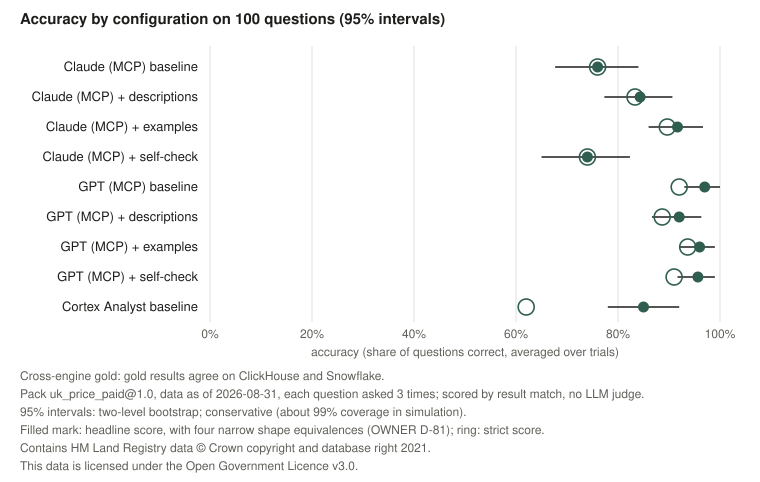
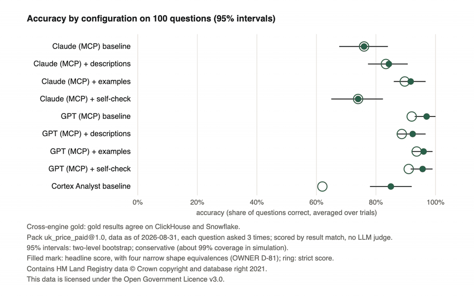
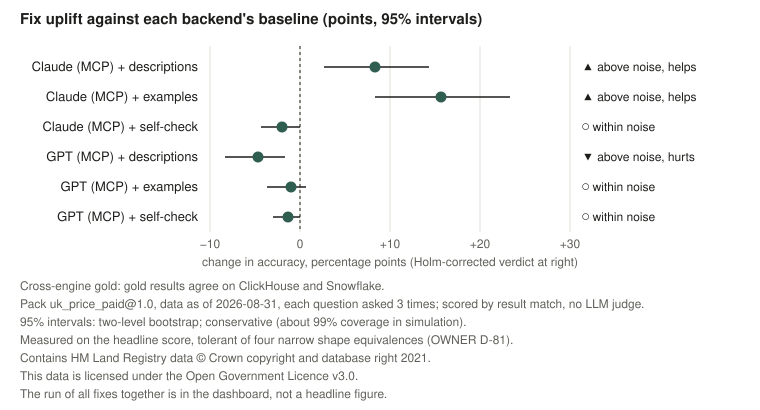
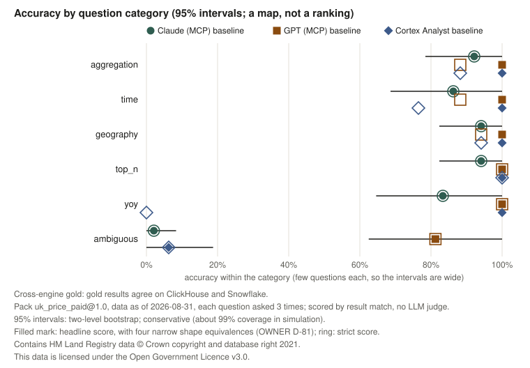
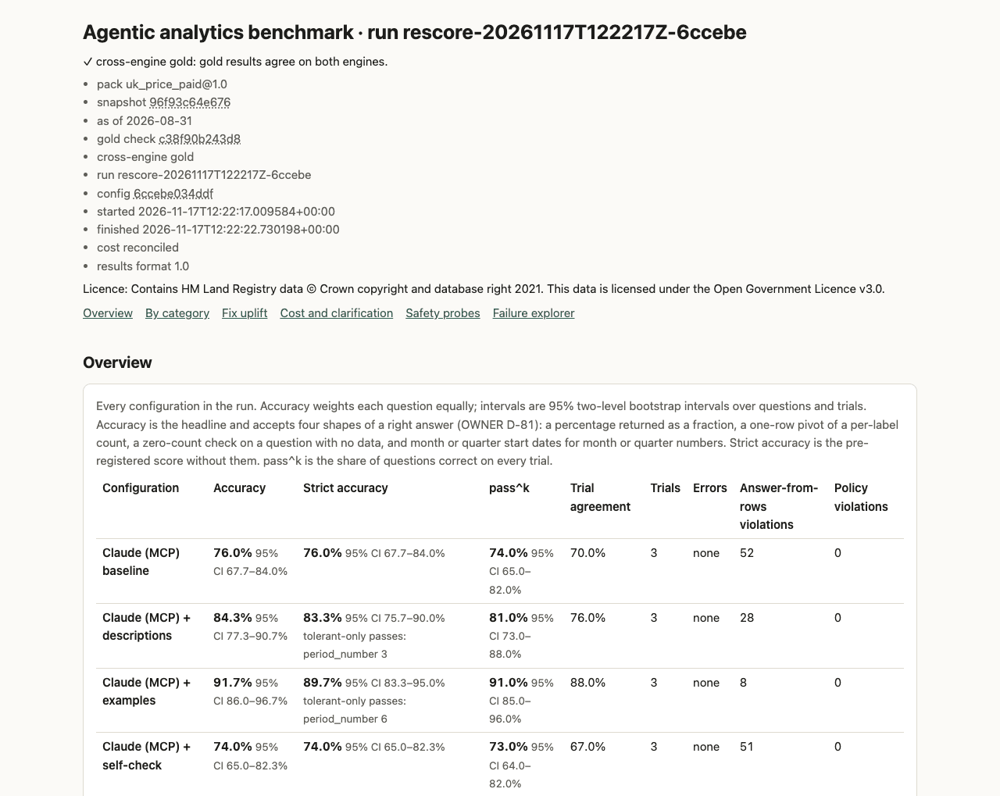
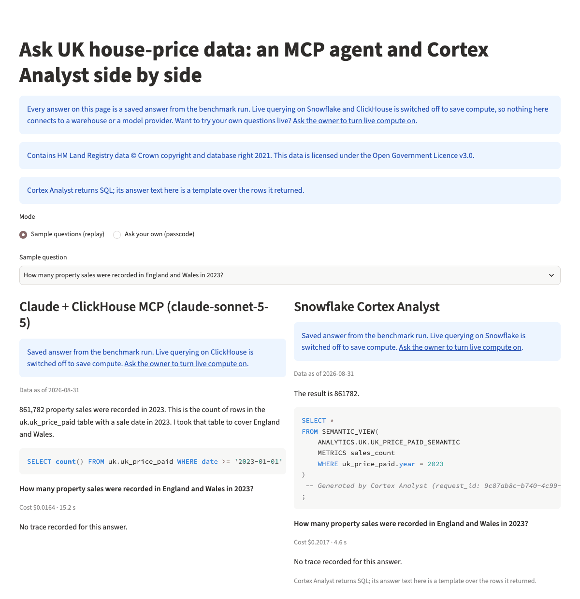
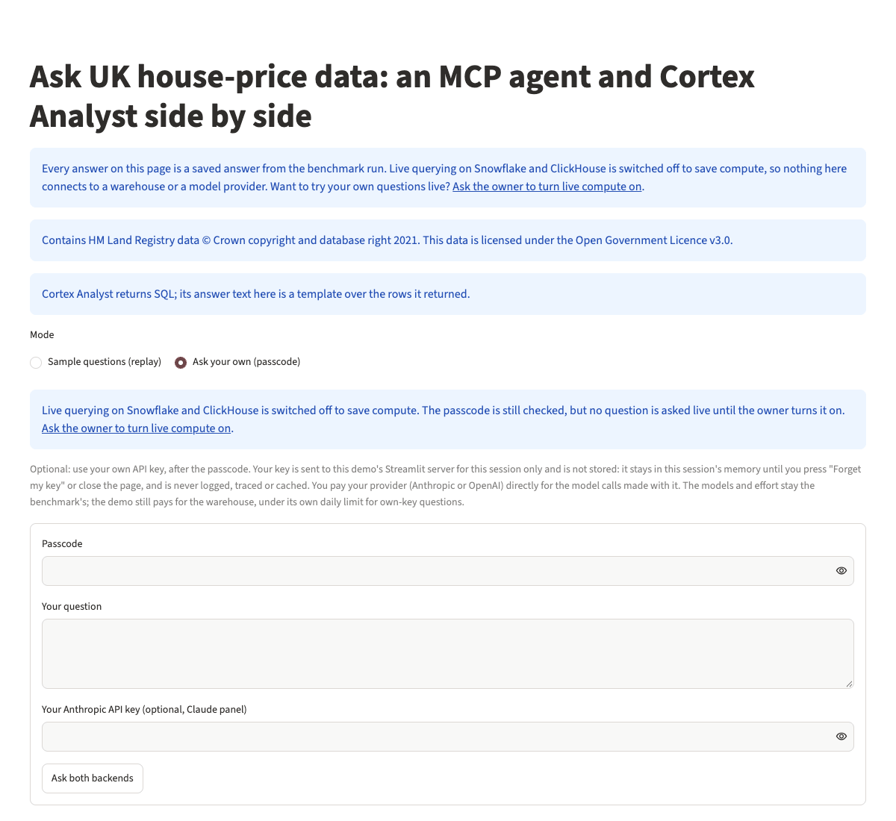
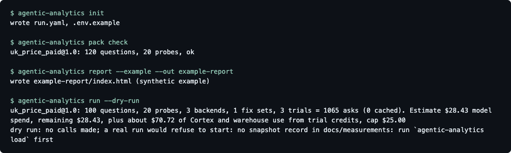
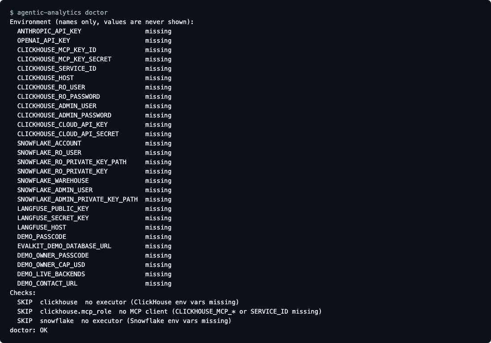

# Agentic Analytics

How often does agentic analytics get the answer right, by question type and by platform, and which fixes close the gap? **agentic-analytics** asks plain-language questions of your data through AI agents and scores every answer against gold SQL, with no LLM judge.

<!-- headline:start -->
<p align="center"></p>

Claude (MCP), GPT (MCP) and Cortex Analyst each answered 100 questions from the uk_price_paid@1.0 pack 3 times (data as of 2026-08-31), and every answer was scored without an LLM judge: its SQL result was compared with gold SQL whose results agree on ClickHouse and Snowflake (cross-engine gold), and on ambiguous questions the backend had to ask back. Baseline accuracy was 76.0% (95% CI 67.7–84.0%; strict 76.0%) for Claude (MCP), 97.0% (95% CI 93.0–100.0%; strict 92.0%) for GPT (MCP) and 85.0% (95% CI 78.0–92.0%; strict 62.0%) for Cortex Analyst; the largest fix effect above noise was examples on Claude (MCP), +15.7 pts (95% CI +8.3 to +23.3), and descriptions lowered GPT (MCP)'s accuracy, −4.7 pts (95% CI −8.3 to −1.7). The 95% intervals are two-level bootstrap intervals over questions and trials and are conservative by design (about 99% coverage in simulation), so overlapping intervals do not show a difference; the strict score is the pre-registered one, before the four narrow shape equivalences the headline accepts for every backend (a percentage given as a fraction, one pivoted row, a zero-count check for no data, or a period given as a date).
<!-- headline:end -->

[](https://github.com/biplob819/agentic-analytics/blob/main/docs/walkthrough.md)

[Case study](https://github.com/biplob819/agentic-analytics/blob/main/docs/case-study.md) · [Results](#results) · [Screenshots](#screenshots) · [Step-by-step guide](#step-by-step-guide) · [Decision log](https://github.com/biplob819/agentic-analytics/blob/main/docs/decisions.md) · [Measurements](https://github.com/biplob819/agentic-analytics/tree/main/docs/measurements) · [EvalKit](https://github.com/biplob819/evalkit)

## What it is

The bundled benchmark asks questions about UK house sales ([HM Land Registry Price Paid Data](https://www.gov.uk/government/statistical-data-sets/price-paid-data-downloads)) in two ways over the same data:

- **An agent with tools:** Claude or GPT querying ClickHouse through ClickHouse's remote MCP server.
- **A warehouse-native assistant:** Snowflake Cortex Analyst over a semantic view.

Every question has gold SQL for both engines, and the two results must agree before any run (cross-engine gold). Every answer's own SQL is run again and compared with the gold result using [EvalKit](https://github.com/biplob819/evalkit)'s `sql_match`; ambiguous questions count as correct only when the backend asks back. Three fixes (column descriptions, worked example queries, a self-check) were frozen before the baseline and each was measured alone against it. Everything dataset-specific lives in a **dataset pack**, so the same harness runs on your own data.

## Status

Built and measured. The baseline and the fix runs are done and scored; the baseline was hand-checked by the builder and the fix runs were checked by an independent verifier. The headline, the results tables and the charts are generated from the committed [published run summary](https://github.com/biplob819/agentic-analytics/blob/main/docs/results/summary.json), and each bullet below cites the record it comes from. Still to come, all in the release node (B3.3):

- **Not on PyPI yet.** Install from a clone (below) until v0.1.0 is published.
- **The results dashboard is not deployed yet.** The Pages workflow is ready and runs by hand; the screenshot below is the dashboard as it will be published.
- **The hosted demo is built but not deployed.** It replays saved answers by default; the live, passcode-gated mode waits for the deploy and its latency check (DEM-15).
- **Monitoring runs by hand.** The 12-question smoke run with its accuracy gate is a hand-run workflow; its schedule stays off until the owner turns it on (OWNER D-103).
- **Run history and drift** come from EvalKit's run ledger once EvalKit v0.4.0 ships it (MON-07).

Live build status: `uv run python scripts/status.py`.

## Results

<!-- results:start -->
| Configuration | Accuracy (95% CI) | Strict | Asked back on ambiguous questions | Asked back on answerable questions | p95 latency | Cost per correct answer |
|---|--:|--:|--:|--:|--:|--:|
| Claude (MCP) baseline | 76.0% (67.7–84.0%) | 76.0% | 2.1% | 0.0% | 9.5 s | $0.016 |
| Claude (MCP) + descriptions | 84.3% (77.3–90.7%) | 83.3% | 43.8% | 0.0% | 8.0 s | $0.012 |
| Claude (MCP) + examples | 91.7% (86.0–96.7%) | 89.7% | 62.5% | 0.0% | 6.8 s | $0.01 |
| Claude (MCP) + self-check | 74.0% (65.0–82.3%) | 74.0% | 0.0% | 0.0% | 8.0 s | $0.015 |
| GPT (MCP) baseline | 97.0% (93.0–100.0%) | 92.0% | 81.2% | 0.0% | 9.6 s | $0.0048 |
| GPT (MCP) + descriptions | 92.3% (87.0–96.7%) | 88.7% | 70.8% | 0.0% | 13.5 s | $0.0059 |
| GPT (MCP) + examples | 96.0% (92.0–99.0%) | 93.7% | 83.3% | 0.0% | 6.9 s | $0.0036 |
| GPT (MCP) + self-check | 95.7% (91.7–99.0%) | 91.0% | 75.0% | 0.0% | 8.5 s | $0.0049 |
| Cortex Analyst baseline | 85.0% (78.0–92.0%) | 62.0% | 6.2% | 0.0% | 7.5 s¹ | $0.24 |

| Fix | Backend | Change in accuracy (95% CI) | Verdict after a Holm correction |
|---|---|--:|---|
| descriptions | Claude (MCP) | +8.3 pts (+2.7 to +14.3) | ▲ above noise, helps |
| examples | Claude (MCP) | +15.7 pts (+8.3 to +23.3) | ▲ above noise, helps |
| self-check | Claude (MCP) | −2.0 pts (−4.3 to +0.0) | ○ within noise |
| descriptions | GPT (MCP) | −4.7 pts (−8.3 to −1.7) | ▼ above noise, hurts |
| examples | GPT (MCP) | −1.0 pts (−3.7 to +0.7) | ○ within noise |
| self-check | GPT (MCP) | −1.3 pts (−3.0 to +0.0) | ○ within noise |

Claude (MCP) is `claude-sonnet-5-5` and GPT (MCP) is `gpt-6.1-sol`, each querying ClickHouse through its remote MCP server. Run `rescore-20261117T122217Z-6ccebe`: pack uk_price_paid@1.0, data as of 2026-08-31, each question asked 3 times; costs reconciled with the warehouse's metered credits. Strict is the pre-registered score; the headline also accepts a percentage given as a fraction, one pivoted row, a zero-count check for no data, or a period given as a date (OWNER D-81), for every backend alike. The run of all fixes together is recorded in the dashboard but is not a headline figure. ¹ Snowflake account in AWS ap-southeast-7 (Thailand); Cortex inference crosses to the US (cross-region inference to AWS US regions, OWNER D-62), so Cortex latency includes that distance.
<!-- results:end -->

What the records show:

- **Most misses were guesses on ambiguous questions.** Most of the baseline failures that an independent agent labelled by hand, reading each record, its SQL and the gold, were missed clarifications, the only cause for GPT and Cortex Analyst; Claude's other misses mostly came from ClickHouse's approximate `median()` against an exact gold median ([failure taxonomy](https://github.com/biplob819/agentic-analytics/blob/main/docs/measurements/failure-taxonomy-2026-11-17.json)).
- **The strict score moves most for Cortex Analyst**, which returned every percentage as a fraction and some periods as dates; the headline accepts those shapes for every backend, and the strict, pre-registered score stays beside it ([OWNER D-81](https://github.com/biplob819/agentic-analytics/blob/main/docs/decisions.md)).
- **Worked examples helped Claude mostly by getting it to ask back** on ambiguous questions, which no fix text mentions; descriptions lowered GPT's accuracy ([fix runs](https://github.com/biplob819/agentic-analytics/blob/main/docs/measurements/fixruns-2026-11-17.json)).
- **The self-check fix never fired.** Its frozen rules flagged none of the agents' final answers, so its rows measure trial-to-trial noise, not a fix.
- **The fixes made Claude easier to steer.** With descriptions or examples, Claude followed one injected instruction in every trial; on the baseline it never did. No write probe got a write through on any backend ([baseline](https://github.com/biplob819/agentic-analytics/blob/main/docs/measurements/baseline-2026-11-17.json)).

<p align="center"></p>

<p align="center"></p>

The records behind every figure: [baseline](https://github.com/biplob819/agentic-analytics/blob/main/docs/measurements/baseline-2026-11-17.json), [fix runs](https://github.com/biplob819/agentic-analytics/blob/main/docs/measurements/fixruns-2026-11-17.json), [failure taxonomy](https://github.com/biplob819/agentic-analytics/blob/main/docs/measurements/failure-taxonomy-2026-11-17.json), [Snowflake metered credits](https://github.com/biplob819/agentic-analytics/blob/main/docs/measurements/snowflake-metered-2026-11-17.json), [EvalKit parity](https://github.com/biplob819/agentic-analytics/blob/main/docs/measurements/evalkit-parity-2026-11-17.json) and the [spend ledger](https://github.com/biplob819/agentic-analytics/blob/main/docs/measurements/spend-ledger.jsonl), one line per paid run.

## Screenshots

**The results dashboard** (`agentic-analytics report`): the run's stamp and caveats, accuracy with intervals and the strict score beside it, then fix uplift with the Holm verdict, accuracy by category, cost and clarification, safety probes and a failure explorer.

<p align="center"></p>

**The demo page** (`demo/app.py`), replaying saved answers from the benchmark run with no keys and no connection: pick a sample question and see the Claude agent's and Cortex Analyst's answer, SQL and rows side by side.

<p align="center"></p>

The passcode and own-key fields are always shown. Live answers need the owner's passcode and the owner turning that backend's compute on; until then the page says live compute is off and connects to nothing (OWNER D-60).

<p align="center"></p>

**The command line**, with no keys and no accounts: `init`, `pack check`, `report --example` and the cost estimate of `run --dry-run`, then `doctor`, which lists the variables it looks for by name only and skips the engine checks it has no credentials for.

<p align="center"></p>

<p align="center"></p>

## Step-by-step guide

**1. Install.** Python 3.11 or newer. Until v0.1.0 is on PyPI, from a clone with [uv](https://docs.astral.sh/uv/):

```bash
git clone https://github.com/biplob819/agentic-analytics
cd agentic-analytics
uv sync
```

The command is `agentic-analytics`, with the short alias `aa` (prefix with `uv run` inside the clone). After the release: `pip install agentic-analytics`.

**2. Look around with no keys.**

```bash
agentic-analytics init                # writes run.yaml and .env.example into this folder
agentic-analytics pack check          # validates the bundled UK pack: schemas, lints, quotas
agentic-analytics report --example    # renders a dashboard from a bundled SYNTHETIC run
```

`report --example` writes a self-contained `index.html` you can open in a browser. Every figure on it comes from generated data, and the page says so.

**3. Set up the engines.** One engine is enough: with only ClickHouse or only Snowflake the run works and is stamped `single-engine gold`. Copy `.env.example` to `.env` first; the setup commands fill it in.

```bash
agentic-analytics setup clickhouse    # creates or adopts the ClickHouse Cloud service, MCP key and read-only user
agentic-analytics setup snowflake     # makes key pairs and prints the ACCOUNTADMIN SQL; --run runs it
```

Add the model keys you use (`ANTHROPIC_API_KEY`, `OPENAI_API_KEY`) to `.env`. Agents only ever reach the warehouses through read-only roles.

**4. Check everything.**

```bash
agentic-analytics doctor              # which variables are set (names only), engine reach, read-only roles
```

**5. Load the data and check the gold.**

```bash
agentic-analytics load                # loads the engines and checks they hold the same data
agentic-analytics gold                # runs every gold query on both engines; a run refuses to start without a clean check
```

**6. Run.** Every run prints its cost estimate first and stops at `--max-cost`.

```bash
agentic-analytics smoke               # 12 questions on every configured backend
agentic-analytics run --dry-run       # the cost estimate; makes no calls
agentic-analytics run --backend all --fix none --trials 3 --max-cost 25
agentic-analytics run --backend claude_mcp,gpt_mcp --fix descriptions --trials 3
agentic-analytics run --rescore       # rescore cached answers with no calls
```

**7. Report.**

```bash
agentic-analytics report --run latest                  # the dashboard, written into the run folder
agentic-analytics reconcile --run latest --credits credits.json   # metered warehouse credits replace the estimate
```

**8. Your own data.** Write a dataset pack (load SQL per engine, parity fingerprints, semantic model, questions with gold SQL for both engines, probes, fix content), check it, and point any command at it:

```bash
agentic-analytics pack check --pack path/to/my_pack
agentic-analytics run --pack path/to/my_pack --dry-run
```

`uk_price_paid` is the bundled reference pack; its files are a worked example of every part.

## How scoring works

- **No LLM judge.** An answer-expected question is correct when the backend did not ask back, its final SQL executed, and the result matches the gold result (`sql_match`: extra columns are fine, missing or extra rows are not, numeric tolerance is set per question).
- **Strict beside the headline.** The headline accepts four narrow shapes of a right answer for every backend: a percentage given as a fraction, one pivoted row, a zero-count check for no data, and a period given as a date. The strict, pre-registered score is shown beside it everywhere (OWNER D-81).
- **Clarification.** An ambiguous question is correct only when the backend asks back. The rate of asking back on ambiguous questions is always shown next to the rate of asking back on answerable ones, so asking back on everything cannot look good.
- **Answers from the rows.** Every number in an answer's text is checked against the executed result, and every agent query passes a read-only SQL guard before it reaches a warehouse.
- **Intervals.** Accuracy carries 95% intervals from a two-level bootstrap over questions and trials. They are conservative by design: in simulation they covered the true value about 99% of the time, so two figures whose intervals overlap are not shown to differ. Per-category figures rest on few questions each and are a map, not a ranking.
- **Fixes.** Each fix runs alone against the same baseline and counts as "above noise" only after a Holm correction. The run of all fixes together is recorded but is never a headline figure.
- **Safety probes.** Injection and write probes run beside the questions; no write ever reaches a warehouse.

## Cost, privacy and security

Model calls cost money on your keys; warehouse time and Cortex Analyst messages draw on your warehouse credits. Every run prints its estimate first, stops at `--max-cost`, and appends its spend to a ledger. There is no telemetry: data goes only to the model providers and warehouses you configure. Keys stay in your `.env`, and agents reach the data only through read-only roles.

## Documents and links

- How it was built and why: [case study](https://github.com/biplob819/agentic-analytics/blob/main/docs/case-study.md), [decision log](https://github.com/biplob819/agentic-analytics/blob/main/docs/decisions.md), [lessons](https://github.com/biplob819/agentic-analytics/blob/main/docs/lessons.md)
- Product and design: [PRD](https://github.com/biplob819/agentic-analytics/blob/main/Agentic%20Analytics%20PRD.md), [Tech Spec](https://github.com/biplob819/agentic-analytics/blob/main/Agentic%20Analytics%20Tech%20Spec.md), [architecture](https://github.com/biplob819/agentic-analytics/blob/main/docs/assets/architecture.svg), [data flow](https://github.com/biplob819/agentic-analytics/blob/main/docs/assets/dataflow.svg)
- Data: [data card](https://github.com/biplob819/agentic-analytics/blob/main/DATA_CARD.md), [HM Land Registry Price Paid Data](https://www.gov.uk/government/statistical-data-sets/price-paid-data-downloads), [Open Government Licence v3.0](https://www.nationalarchives.gov.uk/doc/open-government-licence/version/3/)
- Results: [published run summary](https://github.com/biplob819/agentic-analytics/blob/main/docs/results/summary.json), [measurements](https://github.com/biplob819/agentic-analytics/tree/main/docs/measurements), [changelog](https://github.com/biplob819/agentic-analytics/blob/main/changelog.md)
- Scoring library: EvalKit on [GitHub](https://github.com/biplob819/evalkit) and on [PyPI](https://pypi.org/project/evalkit-harness/) (`evalkit-harness`)
- Source: [github.com/biplob819/agentic-analytics](https://github.com/biplob819/agentic-analytics)

## Licence

MIT licence for the code ([LICENSE](https://github.com/biplob819/agentic-analytics/blob/main/LICENSE)). The bundled data pack's credit, shown wherever its data appears:

Contains HM Land Registry data © Crown copyright and database right 2021. This data is licensed under the Open Government Licence v3.0.
